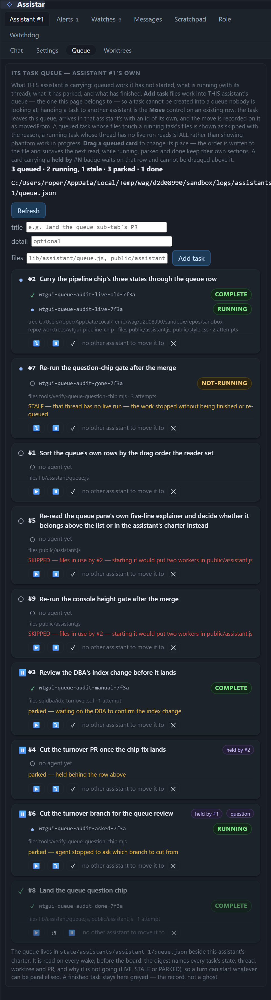
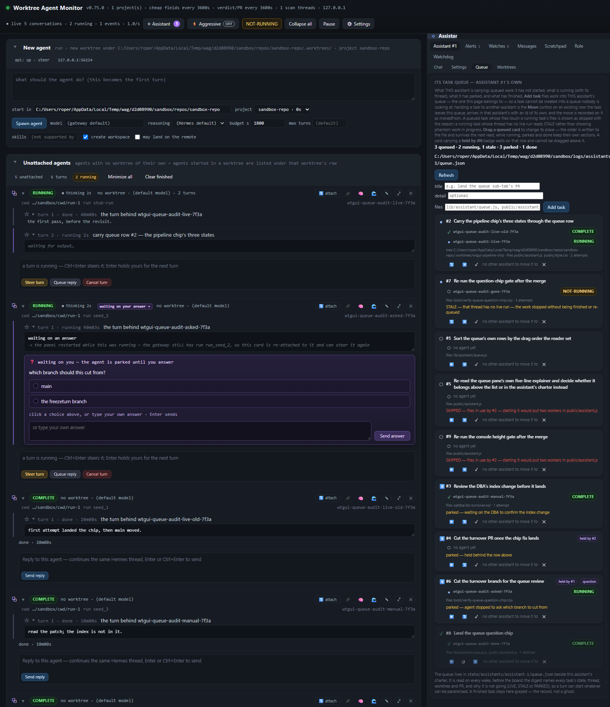
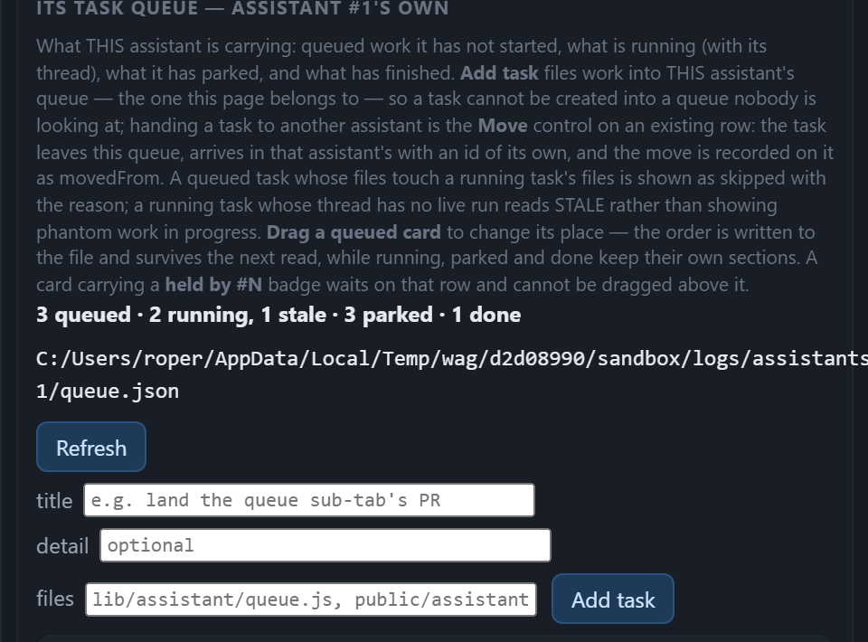
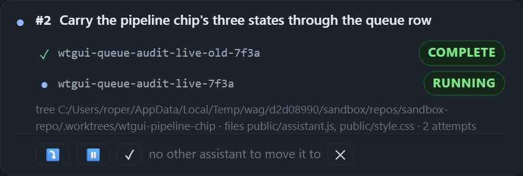
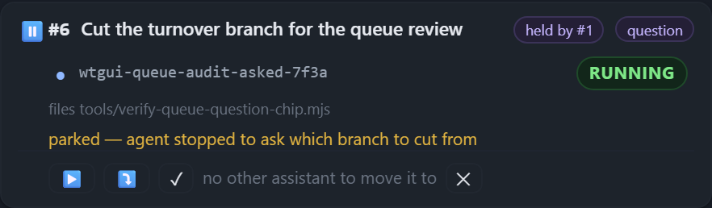
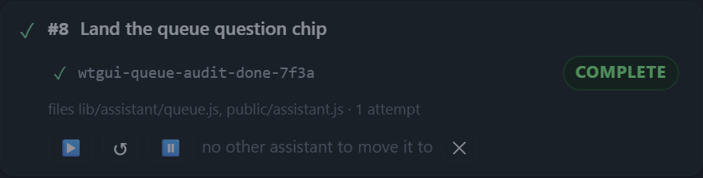

# The assistant queue sub-tab — a read-only visual review

**Scope.** The Queue sub-tab of the assistant rail (`#as-queue`, `renderAssistantQueue` in
`public/assistant.js:2313`), photographed with a seeded queue that carries every row state the pane can draw.
No application code was changed for this review, and nothing under `public/**` was touched.

**How the shots were made.** A sandboxed panel booted from this checkout over its own data directory
(`tools/panel-testkit.mjs`), a stub Runs API so one row has a genuinely live agent, and nine tasks written into
`state/assistants/assistant-1/queue.json`. The question chip is the panel's own join: an OPEN `question` alert in
the assistant's store, matched to its row by thread. Screenshots are Playwright, Chromium, `deviceScaleFactor: 2`
(the `-rail` crops); the page shots are `scale: "css"`. The seed's data directory is a sandbox path, so the path
shown in the counts line is longer than a default `C:/Users/<user>/.wag/assistants/assistant-1/queue.json`; where
a number depends on it, that is said in the finding.

| shot | what it shows |
|---|---|
| `queue-1600.png` | the whole panel at 1600 px, rail docked at 480, queue open |
| `queue-1280.png` | the same at 1280 px |
| `queue-480.png` | a window of 800 px, where the 480 px rail is nearly the whole view |
| `queue-1600-rail.png`, `queue-1280-rail.png`, `queue-480-rail.png` | the rail alone, 2×, every row in frame |
| `queue-pane-top.png` | the chrome above the first task, 2× |
| `queue-row-running.png`, `queue-row-question-and-hold.png`, `queue-row-done.png` | three rows at 2× |

*The whole pane at the rail's own 480 px width, every row in frame (2×).*

**The seed.** Nine rows, one more than the minimum the brief asked for; #9 exists only to show the second red note.

| # | state | what it is |
|---|---|---|
| 1 | queued | no agent yet, one file |
| 2 | running | live run from the stub, two agent threads (one COMPLETE, one RUNNING), worktree + files + 2 attempts |
| 3 | parked, manual | a prose reason, agent's run finished |
| 4 | parked, held | `hold: {kind:"task", value:"#2"}` → `held by #2` chip |
| 5 | queued | a two-line title (the wrap case) |
| 6 | parked + question + hold | `held by #1` **and** `question` on one row, agent's run `waiting` |
| 7 | stale | marked running, its thread has no live run |
| 8 | done | greyed record |
| 9 | queued, conflicts | shares `public/assistant.js` with #2 → `SKIPPED` note |

**One measured fact that frames everything below.** The pane is 479 px wide, the card 441 px, at 1600, at 1280
and at 800. `queue-1600-rail.png` and `queue-1280-rail.png` are byte-identical (`sha256 d52e9b74…`). The rail is a
fixed 480 px dock (`#assistant { width: 480px }`, clamped 340–640 and ≤60 % of the window by `clampDockWidth`), and
the pane has no width of its own to change. So "at 1600, at 1280 and in the 480 px rail" is one composition, not
three: the window width moves the board, never the queue. What follows is about a 441 px column, always.

*The whole panel at 1600 × 1855, rail docked at 480 on the right.*

---

## 1. What the eye lands on first

*Everything above the first task, 2×. The heading, the paragraph, the counts, the path, `Refresh`, and the three
inputs.*

In the rail, in order, from the pixels:

1. **The three add-task inputs.** They are the only filled-white surface in the pane — native `<input type="text">`
   with `rgb(255,255,255)` background, black text and a 2 px inset border, 19 px tall, three of them stacked. Text
   elsewhere is brighter per pixel only where it is glyph-thin; these are the only bright *areas*.
2. **The counts line and the queue's file path.** `3 queued · 2 running, 1 stale · 3 parked · 1 done` is 12 px,
   bold, `--text` (13.0:1); directly under it the full path is set in 11 px `--text` mono, with no truncation and
   no ellipsis, and in this seed it runs to the rail's edge. Together with the Refresh button that has wrapped
   onto its own row, this block is 96 px tall — taller than any task title on the screen.
3. **The Refresh and Add task buttons.** Both `.primary` (blue fill, blue border), both full-size text buttons.
4. **The agent pills.** `RUNNING`, `COMPLETE`, `NOT-RUNNING` at 10.37:1 on green/amber — the loudest *small*
   element in the pane, and the most saturated colour at full opacity.
5. **The task titles.** 11.5 px, `--text`, 13.0:1. Yes: the titles are last, behind the form that creates one.

So the pane opens with 372 px — 22 % of its 1 658 px height — of explanation, a counter and an input form, and
then repeats that hierarchy inside every row (badge louder than title, title louder than the sentence that says
why the row is stuck). The work is the quietest thing in a pane whose only job is the work.

Two mechanisms do most of this:

- **The chrome is set as brightly as the content.** The help paragraph is `--dimmer` (fine), but the counts line,
  the path and the input fills are not.
- **The skin's own surface has been flattened.** `.as-task` is `background: var(--panel-2)` on an `.as-group` of
  `var(--card)`, and `border: 1px solid var(--line)`. Measured: card `rgb(29,35,43)` against group `rgb(24,29,38)`
  = **1.07:1**; the card's border against its own fill = **1.05:1**. The 9 px radius is there, the surface is not:
  rows are separated by the 8 px gap alone, and the "card" reads as a slightly lighter rectangle in a column of
  slightly lighter rectangles. (The panel's contrast setting lifts the tokens; at this setting the pair is
  effectively one tone.)

---

## 2. What is wrong

Each finding is a fact from the shots or the DOM, not a preference. Numbers are measured at 1600×1855, DSF 2.
Density is F1–F6 and F10–F11, colour is F7–F9 and F12, hierarchy is F2/F6/F8/F13, alignment is F14–F15.

### F1 — The pane explains itself for 372 px before it shows a task
`chromeBeforeFirstRow = 372` of a 1 658 px pane; the first task starts at y 372. Of that, the help paragraph is
147 px and the counts line is 96 px.

### F2 — That explanation is 1 038 characters of prose, set at 10.5 px and 3.58:1
The `.as-help` under the `<h4>` is 10 lines / 147 px, `font-size: 10.5px`, `color: var(--dimmer)` = **3.58:1** on
the group surface — under AA's 4.5:1 for text of its size, and it is the bulk of the pane's first screen. Its only
structure is inline `<b>` (`Add task`, `Move`, `STALE`, `Drag a queued card`, `held by #N`). The section's own
title (`ITS TASK QUEUE — ASSISTANT #1'S OWN`) is 10.5 px uppercase `--dimmer`, i.e. quieter than the bold words
inside the paragraph it introduces.

### F3 — A second help block closes the pane, repeating the first
Four more lines / 60 px after the last card (`The queue lives in state/assistants/… It is read on every wake…`),
same 3.58:1. The pane therefore opens and closes with prose, and the last thing under the last task is not a task.

### F4 — The counts line is four rows tall, and prints the path in full
`.as-group .as-line` is `flex; flex-wrap: wrap; font-size: 12px`. It holds the `<b>` counts, the `<code>` file and
the Refresh button. Measured: the line is **96 px tall** — counts on one row, the path on two more, and Refresh
pushed onto a fourth. There is no truncation on the `<code>`: it is printed at its full width, which in this seed
is **534 px inside a 441 px line** and runs past the card's right edge to the rail's border (visible in
`queue-pane-top.png`). The default data directory (`~/.wag`) gives a 58-character path — about 383 px at 11 px
mono, which just fits — so how bad this looks depends on `dataDir`/`WAG_HOME`; what does not depend on it is that
the reader is shown a file path, unconditionally, in the line that is supposed to be a count.

### F5 — Three unstyled native inputs are the brightest objects in the pane
`#as-qtitle-1`, `#as-qdetail-1`, `#as-qfiles-1` compute to `background: rgb(255,255,255)`, `color: rgb(0,0,0)`,
`border: 2px inset rgb(118,118,118)`, `border-radius: 0`, `height: 19px`. `.as-group select` and
`.as-group input[type="number"]` (style.css:3301) get the surface/border/radius treatment; `.as-group
input[type="text"]` (style.css:3304) sets only `font-family`, `font-size`, `min-width` and `flex`. So the one dark
panel in the product shows three white boxes with black text, 19 px tall — the highest luminance in the pane, on
elements the reader has to aim at.

### F6 — Two primary buttons outrank every row
`Refresh` and `Add task` are both `class="primary"` (blue fill + blue border). They are text buttons at 11.5–12 px,
sitting at the top of the pane, and they are the two largest buttons in it. A reader scans the pane as
"form with two buttons, then a list", which is the reverse of what it is.

### F7 — State is carried by colour, and two of the four states are the same colour
`.as-task-mark` paints `○` `--dim`, `●` `#8fb8ff`, `⏸` `#a78bfa`, `✓` `#6fcf97`. Two consequences:

- **`⏸` never paints its colour.** U+23F8 resolves to the colour-emoji font: the computed `color` is
  `rgb(167,139,250)` but the pixels are `rgb(90,175,251)` (sampled in `queue-1600-rail.png` at rows #4 and #6). The
  parked marker is a blue emoji pause button, not a violet glyph, and it matches the emoji `⏸` and `▶`/`⤵` in every
  action strip. Three state marks are text glyphs and the fourth is a colour emoji, so the stylesheet's colour for
  the parked state never reaches the screen at all.
- **Stale and running wear the same mark.** Row #7 is `state: running` → `●` `#8fb8ff`, the same as row #2 which
  has a live run. The only difference is the amber note below and an amber `NOT-RUNNING` pill on the sub-row: the
  head of the row says "running" in blue while the row says "stopped" twice in amber.

### F8 — `RUNNING` and `COMPLETE` are the same green pill
`.pill.pill-running` is `#7ee787` on `var(--green-bg)`; `button.pill-complete` is `#7ee787` on `var(--green-bg)`.
Same hue, same fill, same radius, same 10.5 px uppercase bold, and they sit one above the other on row #2 (10.37:1
each). One is static text, the other is a button whose press queues an ask — so the pair differs in meaning, in
affordance and in nothing visible. Green therefore means "working" and "finished" at once, which is the one
distinction a queue exists to make.

*Row #2, 2×: `COMPLETE` and `RUNNING`, the same green, one above the other. `COMPLETE` is a button; `RUNNING` is a
label.*

### F9 — One row can carry five signals, and two of them are the same skin
Row #6 carries, top to bottom: a blue pause-emoji marker, a green `RUNNING` pill, a purple `held by #1` chip, a
purple `question` chip, an amber `parked — agent stopped to ask which branch to cut from` note, and a 9 px
`question` chip that repeats the note in one word. The chips share `.as-task-hold` exactly (`margin-left: auto`,
9 px, `#c4b5fd` on `#241f36`), so "this row is held by another row" and "an agent is waiting for you to answer"
are the same object in the same colour, differing only by their word. The two chips together take about 110 px of
the 441 px head — a quarter of the title's width — on the far right, away from the title they qualify.

*Row #6, 2×: `held by #1` and `question` in the same purple pill, a green `RUNNING` pill, the amber note that says
the same thing as the `question` chip, and the glyph strip.*

### F10 — Every row repeats a ten-word sentence in its action strip
With one assistant configured, `others.length === 0`, so `queueTaskHtml` renders
`no other assistant to move it to` (assistant.js:2243) in **all nine rows** — a 10.5 px
sentence sitting between the glyphs of the action strip, where the eye reads it as a control that is disabled. Nine
copies of a statement about the deployment, not about the task, and in each row it is the longest single piece of
text in the strip.

### F11 — The action strip is glyph-only, 19 px tall, and two of its buttons are emoji
`.as-task-actions` is 27 px tall; the buttons measure **22–29 × 19 px** (`padding: 3px 6px; min-width: 22px`), well
under a 24 px target. Their visible content is `▶ ⤵ ⏸ ✓ ➡️ ✕`; the words exist only in `title=`/`aria-label=`.
`⤵`, `⏸` and `➡️` render as colour emoji, `✓` and `✕` as text glyphs — so one strip mixes two icon languages, and
`✕` (delete) sits at the same size and weight as `✓` (done) 8 px away. Nine rows carry 36 such buttons, and on a
row at rest most of them offer a press the reader did not come to make.

### F12 — The done row is dimmed with `opacity`, so its text fails and its badge does not
`.as-task.is-done { opacity: .55 }` multiplies everything in the card, including the text the record exists to
show: title **4.93:1**, meta **1.94:1** (down from 3.35:1), while `button.pill-complete` inside it stays the
brightest object on the row because green at 55 % is still green. The record is the least readable row and its
badge is the most readable thing in it.

*Row #8, 2×: everything at 55 %, so the meta line all but disappears while `COMPLETE` stays fully green.*

### F13 — Secondary text is the smallest thing on screen, in the least contrast
`.as-task-meta` is 9.5 px at `--dimmer` = **3.35:1**; `.as-task-agent-thread` is 10 px `--dim`; the chips are 9 px;
the pill is 10.5 px uppercase. The three facts a reader needs to decide what to do next — which tree, which files,
how many attempts — are set below every other text in the pane, and the meta line is usually mostly a path
(`tree C:/…/sandbox-repo/.worktrees/wtgui-pipeline-chip · files … · 2 attempts`), which wraps mid-path on row #2
and pushes that row to 149 px.

### F14 — The row rhythm is uneven, and a wrapped title breaks the head's baseline
Row heights: 104, 105, 110, 122, 128, 129, 138, 142, 149 px — a 45 px spread with an 8 px gap, because the title
(1–2 lines) and the meta line (1–2 lines) wrap independently. On row #5 (2-line title) the head is
`align-items: center`: the marker sits at y 1034, the `#5` at 1031 and the title's first line at 1023, so the id
and the marker drift 8–11 px below the line they belong to. On every other row the three are within 3 px.

### F15 — `held by #N` and `question` are the same pixel object as a *status*, but nothing says which is actionable
The `question` chip is a `<button>` (Enter/Space work; pressing opens the agent's card); the `held by #N` chip is a
``. They are indistinguishable at rest — same size, same fill, same 9 px word — so the one control in the
head does not look pressable and the one label does.

---

## 3. What to change

Every suggestion names the rule or the prop it moves. They are ordered by how much of the problem each removes.
The `.as-task` skin (`style.css:3321`, `border-radius: 9px`, `padding: 8px 10px`, `margin: 0 0 8px`,
`background: var(--panel-2)`, `box-shadow: 0 1px 2px #0006`) is the reference: a raised surface, one left rail,
one anchored action row, and nothing in the row louder than the row.

### S1 — Collapse the explainer to one line plus a disclosure (F1, F2, F3)
Replace the 1 038-character `.as-help` block in `renderAssistantQueue` (assistant.js:2346–2354) with one sentence
and a `
` whose summary is `what this pane is`. Delete the closing `.as-help`
(assistant.js:2365–2368) outright — it repeats the file path and the "finished stays greyed" rule the empty state
already says. CSS-only fallback if the markup is not touched:
`.as-group > .as-help { display: -webkit-box; -webkit-box-orient: vertical; -webkit-line-clamp: 2; overflow: hidden; }`.
Target: ≤ 60 px of chrome, not 207.

### S2 — Make the counts a caption and take the path out of the line (F4, F6)
Give the counts their own line without the button, and demote it: `.as-group .as-qcounts { font-size: 10.5px;
font-weight: 400; color: var(--dim); letter-spacing: .02em; }`. Move `view.file` into a `title=` on the counts
(``), or set
`.as-group .as-line code { flex: 1 1 auto; min-width: 0; overflow: hidden; text-overflow: ellipsis; white-space: nowrap; }`
so it truncates instead of pushing the line to 534 px. Refresh belongs with the other quiet controls (S5), not on
the counts line.

### S3 — Style the three inputs as fields of this panel, not as the browser's (F5)
Add to the existing `.as-group input[type="text"]` rule (style.css:3304) what its sibling already has (3301):
`background: var(--surface); color: var(--text); border: 1px solid var(--line); border-radius: 5px; padding: 4px 6px;
height: 26px;` and drop `min-width: 250px` to `min-width: 0` so the field shrinks with the column. Target: no
`rgb(255,255,255)` anywhere in the pane.

### S4 — Put the whole add-task form behind one press (F1, F5, F6)
`renderAssistantQueue` always paints title/detail/files/Add task (assistant.js:2356–2361). Wrap them in a
`
` whose `
` is the current `Add task` `.primary` button, or paint only a
`button.as-qadd-open` and build the form on first press (state in the existing `qmoveOpen`-style Set). That removes
~110 px of chrome and both primary buttons from the resting view, leaving `+ Add task` at 24 px.

### S5 — Demote both primary buttons (F6)
`Refresh` and `Add task` are `.primary`. Use the quiet button the rest of the group uses (the `button` rule that
`.as-task-actions button` overrides) and keep `.primary` for the one press the reader came to make — which, after
S4, is inside the fold. Concretely: replace `class="primary"` on both with `class="as-qquiet"` and
`.as-group .as-qquiet { background: transparent; border: 1px solid var(--line); color: var(--dim); font-size: 10.5px;
padding: 2px 7px; }`.

### S6 — Say the state in words, in the title's own colour (F7, F8, F9, F12)
Add one word to the head from `queueStateName(t.state)` in `queueTaskHtml` (assistant.js:2246–2252):
`${state}`, styled as a text label rather than a pill —
`.as-task-state { font-size: 9.5px; letter-spacing: .06em; text-transform: uppercase; color: var(--dim); }` — and
leave the glyph as the accent only. A stale row then reads `STALE` in the head (pass `t.stale ? "stale" :
queueStateName(t.state)` as the prop) instead of a blue `●`, which removes the row that contradicts itself.
`.as-task-mark.is-parked` should also stop being an emoji: `font-variant-emoji: text` on `.as-task-mark`, or swap
U+23F8 for `‖`. Any one of these makes state legible with the colour switched off.

### S7 — Give `RUNNING` and `COMPLETE` different colours (F8)
`.pill.pill-running` (style.css:1024) and `button.pill-complete` (style.css:1098) should not both be `#7ee787`. Keep
green for the finished record (`--green` on `--green-bg`) and move the live pill to the blue the running marker
already uses: `.pill.pill-running { color: #8fb8ff; border-color: #24384f; background: #101d29; }`. Then green
means "done", blue means "going", amber means "stopped", and the queue's central question is answerable at a
glance.

### S8 — Separate the two chips, and put the question where it can be pressed (F9, F15)
`queueQuestionChip` reuses `.as-task-hold` on purpose (assistant.js:2095–2102). Give it its own class,
`.as-task-question { font-size: 9.5px; color: #ffd7a8; background: #2a2014; border: 1px solid #4a3a1f; border-radius:
999px; padding: 1px 7px; }`, with a "?" word and `cursor: pointer` so the one pressable chip looks pressable; leave
`.as-task-hold` for the `held by #N` label at `--dim`. Move both out of `.as-task-head` and onto the anchored
action row (or under the meta line) so they stop eating the title's width and stop being read as status of the
head.

### S9 — Delete the per-row "no other assistant to move it to" (F10)
Two options, both one line: paint the hint only when the pane has ever had a second assistant
(`assistant.js:2243` → return `""` when `others.length === 0`, since the Move control is absent anyway), or hide it
with `.as-task-actions .as-hint { display: none; }` — the row already has `title` on the picker for the case it
matters. That removes nine sentences from the pane.

### S10 — Make the action strip words, not glyphs (F11)
`.as-task-actions .as-qglyph` is `min-width: 22px; padding: 3px 6px`. Raise the target and give the destructive
control its own weight: `.as-task-actions button { min-height: 24px; padding: 2px 8px; }`,
`.as-task-actions [data-as-qact="delete"] { margin-left: auto; color: var(--dim); }`, and label at least the row's
primary transition in words (`Start` / `Park` / `Done`) rather than `▶`/`⏸`/`✓`. Two glyphs per row is a legend;
six is a puzzle — and three of the six are emoji, which no other control in the panel uses.

### S11 — Stop dimming the record (F12)
Replace `.as-task.is-done { opacity: .55 }` (style.css:3323) with a surface-and-type change: `.as-task.is-done {
background: var(--card); } .as-task.is-done .as-task-title { color: var(--dim); font-weight: 400; }
.as-task.is-done .as-task-meta, .as-task.is-done .as-task-note { color: var(--dimmer); }` — the row stays quiet
without dropping its meta to 1.94:1, and the `COMPLETE` pill stops being the only legible thing in it.

### S12 — Lift the secondary text to a readable size (F13)
`.as-task-meta` 9.5 px → 10.5 px with `color: var(--dim)` (6.27:1 on the card); `.as-task-hold` 9 px → 9.5 px;
`.as-task-agent-thread` 10 px → 10.5 px. And give the meta line a `max-width` with
`overflow: hidden; text-overflow: ellipsis; white-space: nowrap` per item, so a path cannot wrap a row to 149 px.

### S13 — Anchor the head so a wrapped title does not drift (F14)
`.as-task-head { align-items: center }` (style.css:3341) → `align-items: baseline` with `.as-task-mark { align-self:
flex-start; margin-top: 1px; }`, or `align-items: flex-start` plus `.as-task-head b { line-height: 1.4 }`. The
marker, the id and the first line of the title then share a baseline on every row, wrapped or not.

### S14 — Make the card's surface do the separating (the skin's own intent)
The `.as-task` skin asks for a raised surface; measured it is 1.07:1 against the group and its border 1.05:1
against its own fill. Either take the card one step off the group (`background: var(--surface)` is darker, not
lighter — the lighter neighbour is what works here: keep `var(--panel-2)` but drop the group to `var(--bg)`), or
lean on the border (`border-color: #2c3442`) so the 9 px radius is visible. Same for the gap: `margin: 0 0 8px`
equals the card's own top padding, so consecutive cards read as one ribbon; `margin-bottom: 10px` gives the skin's
spacing a rhythm.

---

## 4. Appendix — the numbers behind the findings

Measured in the seeded panel at 1600×1855, `deviceScaleFactor: 2`; contrasts are WCAG 2.x ratios computed from
the rendered colours, with `opacity` composited for the done row.

| thing | measured |
|---|---|
| pane / card width | 479 px / 441 px, identical at 1600, 1280 and 800 |
| pane height with 9 rows | 1 658 px |
| chrome before the first row | 372 px (22 %) |
| help paragraph | 1 038 chars, 10 lines, 147 px, 10.5 px, 3.58:1 |
| closing help paragraph | 4 lines, 60 px, 3.58:1 |
| counts line | 96 px tall; `<code>` 534 px inside a 441 px line (this seed's dataDir) |
| add-task inputs | 255,255,255 fill, 0,0,0 text, 2 px inset, 0 radius, 19 px tall |
| card fill vs group fill | 1.07:1 |
| card border vs card fill | 1.05:1 |
| title | 11.5 px, 13.01:1 (4.93:1 when done) |
| meta | 9.5 px, 3.35:1 (1.94:1 when done) |
| agent thread | 10 px, `--dim` |
| chips | 9 px, 16–17 px tall, 49–56 px wide |
| pills | 10.5 px uppercase bold, 10.37:1; RUNNING and COMPLETE identical (`#7ee787` on `#12261a`) |
| action strip | 27 px tall; 4 buttons, 22–29 × 19 px; 36 buttons across 9 rows |
| repeated hint | `no other assistant to move it to`, in all 9 rows |
| row heights (sorted) | 104, 105, 110, 122, 128, 129, 138, 142, 149 px |
| parked marker's paint | computed `rgb(167,139,250)`, pixels `rgb(90,175,251)` (emoji `⏸`) |

---

## 5. If we only do three things

1. **Cut the chrome to one line (S1 + S2 + S4).** Fold the 1 038-character explainer and the add-task form behind
   one press each, and make the counts a 10.5 px caption with the path in a `title=`. That takes the pane from
   372 px of preamble before the first task to under 100, and puts the first task where the eye already is.
   Files: `renderAssistantQueue` (assistant.js:2343–2369), `.as-group .as-help` / `.as-group .as-line`.
2. **Stop the form out-shouting the work (S3 + S5).** Give `.as-group input[type="text"]` the surface, border,
   radius and 26 px height its sibling rule already has, and demote `Refresh`/`Add task` off `.primary`. One CSS
   rule and two class attributes remove the only white fills and the two largest buttons in the pane.
3. **Let state be read without colour (S6 + S7).** Put the state word in the head (`STALE` for a stale row, not a
   blue `●`), and split `RUNNING` from `COMPLETE` by hue. A reader who cannot tell blue from green — or who is
   looking at a greyscale screenshot — can then still answer "what is running, what is finished, what is stuck",
   which is the whole contract of the tab.
