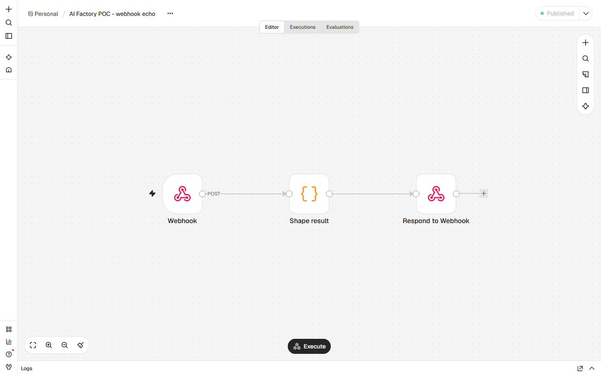
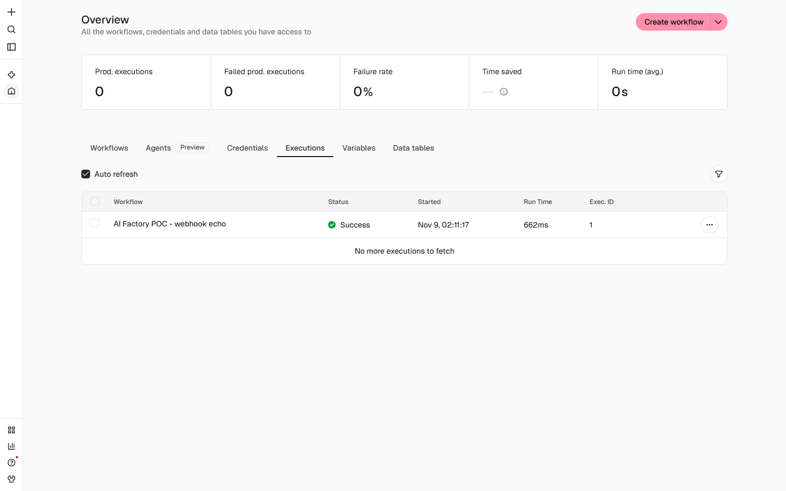

# An n8n POC on the panel's box

Run on 2026-11-09 against the n8n instance already running in Docker on this box. The question is narrow: can a
script create a workflow, publish it, call its webhook and read the execution back, using nothing but an HTTP
client, and which of n8n's two HTTP surfaces does that script have to authenticate against? The answer is that
`POST /webhook/poc-ai-factory` returned 200 with a computed body, execution 1 is `success`, and the surface to
build on is the public `/api/v1` with an `X-N8N-API-KEY`, not the editor's session-bound `/rest`.

Every request and response below was recorded by the run itself, with a client-measured latency beside it. The
calls were made between 06:55Z and 07:11Z on 2026-11-09. The two screenshots were captured at 07:49Z, when the
workflow frame was re-taken because the first capture had a popover over the canvas (see Screenshots). Nothing
was re-run to write this document: the calls are the run's ledger, and the only later traffic was two GETs at
07:51Z, reported separately under "State when this document was written".

## Target and before state

- Endpoint: `http://127.0.0.1:5678`, loopback only. The container publishes the port on `127.0.0.1`, so nothing
  off this box can reach it.
- Container, from `docker ps`: `n8n | docker.n8n.io/n8nio/n8n:latest | Up 2 days | 127.0.0.1:5678->5678/tcp`.
- Version: `n8n --version` inside the container reports `2.46.6`. Image id
  `sha256:8602f5dfacbe2c931eeafd010de0e68182310e9f309921e780ab69182e92b3ae`, created `2026-11-04T13:04:10Z`. The
  `latest` tag is not pinned; the digest is what identifies this build.
- Workflows before the run: none. `GET /api/v1/workflows` returned `{"data":[],"nextCursor":null}` twice, once
  with the session cookie (call `3`) and once with the API key (call `D`).
- The owner account pre-existed. The person record returned by the setup call carries
  `createdAt: 2026-11-06T20:49:35.556Z` and `role: global:owner`, three days before this run, so the call at
  06:55Z returned an existing account rather than claiming a fresh instance. The instance had already been set up
  with email/password authentication; `showSetupOnFirstLoad` is `false`.
- Instance settings, public and unauthenticated (call `B`, 476 bytes): SSO off for SAML, LDAP and OIDC, auth
  cookie not marked secure, community nodes enabled, mail setup absent. Nothing in the run depended on mail, and
  nothing sent any.

## The auth answer for both surfaces

There are two HTTP surfaces on the same port and they authenticate differently. Both were probed, and the
difference is the reason this POC's scripts use the first one.

**Public API, `/api/v1`.** Key based, and the key goes in a header, not a query string:

- No credentials at all: `401`, body `{"message":"Unauthorized"}`, 26 bytes (call `C`, 11.6 ms).
- With the `X-N8N-API-KEY` header set to the key: `200`, body `{"data":[],"nextCursor":null}`, 29 bytes (call
  `D`, 52.2 ms).
- With the browser session in a cookie jar and no key: `200` on the same path (call `3`, 29 bytes). Calls `C`
  and `3` differ only in whether the jar carried the session, so the public API also honours the editor cookie.
  That is convenient for a browser and a reason not to treat the key path as the only door.
- Writes return `200`, not `201`. `POST /api/v1/workflows` answered 200 with the created object (call `E`).

The key used here was created through the editor surface by the owner session (call `7`): id
`Ma27KWs1IsfdVKqz`, label `poc-ai-factory-machine`, audience `public-api`, 36 scopes (credentials, executions,
projects, tags, variables and workflows, including `workflow:activate`), no expiry. The response carries the
secret twice, once masked to its last four characters and once in `rawApiKey`; the raw value is the one a client
uses. It is not in this repository and not reproduced in this document.

**Internal API, `/rest`.** Session bound and undocumented. `POST /rest/login` sets an `n8n-auth` cookie, and the
rest of the editor surface answers to that cookie: `/rest/api-keys`, `/rest/api-keys/scopes`,
`/rest/owner/setup` all returned 200 with the jar. It is not a stable contract:

- `GET /rest/me` returned `404` with the body `<pre>Cannot GET /rest/me</pre>` (call `2`, 146 bytes). The route
  does not exist in 2.46.6, so a script written against a tutorial's `/rest/me` check cannot even prove it is
  logged in.
- `GET /rest/settings` is public and answers 200 with no credential at all (call `B`), which is how the instance
  settings above were read.

The answer for the panel, if it ever talks to n8n: use `/api/v1` and a key. The `/rest` routes are the editor's
own plumbing, they move between versions, and at least one of them that older notes rely on is simply absent
here.

## The workflow

Created by call `E` and published by call `G`. Id `obtlKZkEdITo7Xtr`, name `AI Factory POC - webhook echo`.

| Node | Type | Type version | Position |
| --- | --- | --- | --- |
| `Webhook` | `n8n-nodes-base.webhook` | 2 | -300, 0 |
| `Shape result` | `n8n-nodes-base.code` | 2 | 0, 0 |
| `Respond to Webhook` | `n8n-nodes-base.respondToWebhook` | 1.1 | 300, 0 |

Edges: `Webhook` -> `Shape result` -> `Respond to Webhook`.

Webhook node parameters: `httpMethod: POST`, `path: poc-ai-factory`, `responseMode: responseNode`, so the
response is the body of the last node rather than an acknowledgement. The full URL is
`http://127.0.0.1:5678/webhook/poc-ai-factory`.

The code node, verbatim:

```js
const item = $input.first().json;
const body = (item && item.body) || {};
const items = Array.isArray(body.items) ? body.items : [];
const score = Number(body.score || 0);
const name = String(body.name || '');
return [{ json: {
  ok: true,
  received: { name: name, score: score, itemCount: items.length },
  computed: { doubledScore: score * 2, nameUpper: name.toUpperCase(), itemsSorted: items.slice().sort() },
  servedBy: 'n8n-poc-webhook',
  processedAt: new Date().toISOString()
} }];
```

Publishing set `active: true`, `activeVersionId: 8cf6a64f-4f0a-4e8a-a57c-0fc7c0df2a5b`, `versionCounter: 1`, and
embedded the published version under `activeVersion`. The workflow carries no credentials and calls no external
service.

## Calls, with measured latency

Every latency is measured on the client with `time.perf_counter()` around the request, including reading the
response body. It is a single run, no warm-up, no repetition, so the numbers describe this run and are not a
benchmark. Response bytes are what the client read off the wire. Across all 19 calls: 16 answered 200, two 404,
one 401; 32,545 response bytes in total; latency min 11.6 ms, mean 195.0 ms, max 848.3 ms.

| Step | Request | HTTP | Client latency (ms) | Response bytes |
| --- | --- | --- | --- | --- |
| `1-owner-setup` | POST `/rest/owner/setup` | 200 | 744.2 | 4870 |
| `2-me` | GET `/rest/me` | 404 | 57.5 | 146 |
| `3-api-v1-with-session-cookie` | GET `/api/v1/workflows` | 200 | 363.5 | 29 |
| `4-api-keys-list` | GET `/rest/api-keys` | 200 | 31.8 | 89 |
| `5-login` | POST `/rest/login` | 200 | 207.9 | 4856 |
| `6-api-key-scopes` | GET `/rest/api-keys/scopes` | 200 | 44.0 | 2131 |
| `7-api-key-create` | POST `/rest/api-keys` | 200 | 111.7 | 1187 |
| `A-root` | GET `/` | 200 | 57.9 | 1618 |
| `B-rest-settings` | GET `/rest/settings` | 200 | 17.7 | 476 |
| `C-api-v1-no-credentials` | GET `/api/v1/workflows` | 401 | 11.6 | 26 |
| `D-api-v1-with-key` | GET `/api/v1/workflows` | 200 | 52.2 | 29 |
| `E-workflow-create` | POST `/api/v1/workflows` | 200 | 221.7 | 2283 |
| `F-workflow-get` | GET `/api/v1/workflows/obtlKZkEdITo7Xtr` | 200 | 37.9 | 2283 |
| `G-workflow-publish` | POST `/api/v1/workflows/obtlKZkEdITo7Xtr/publish` | 200 | 656.9 | 3648 |
| `H-workflow-get-after-publish` | GET `/api/v1/workflows/obtlKZkEdITo7Xtr` | 200 | 121.8 | 4136 |
| `I-webhook-call` | POST `/webhook/poc-ai-factory` | 200 | 848.3 | 238 |
| `J-webhook-get-method` | GET `/webhook/poc-ai-factory` | 404 | 29.5 | 110 |
| `K-executions-list` | GET `/api/v1/executions?workflowId=obtlKZkEdITo7Xtr&includeData=false` | 200 | 52.5 | 254 |
| `L-workflow-final` | GET `/api/v1/workflows/obtlKZkEdITo7Xtr` | 200 | 37.0 | 4136 |

The first seven calls are the setup: claim or read the owner account, learn what the two surfaces will answer,
log in, list the scopes an API key can be granted, then mint one. Calls `A` to `L` are the POC proper, and are
the twelve-call series a reader can replay end to end.

### `1-owner-setup`

```
POST /rest/owner/setup
```

```json
{
  "email": "<owner email>",
  "firstName": "POC",
  "lastName": "Owner",
  "password": "<redacted>"
}
```

Response, HTTP 200, 4,870 bytes, 744.2 ms. The body is the owner person record: `kind: person`, id
`bf4af7a6-523e-4597-9ee7-9537e88233b4`, `role: global:owner`, `isOwner: true`, `signInType: email`,
`mfaEnabled: false`, `createdAt: 2026-11-06T20:49:35.556Z`, and 213 `globalScopes`. The `createdAt` is the
evidence that this call read an existing account rather than creating one.

### `2-me`

```
GET /rest/me
```

no body. Response, HTTP 404, 146 bytes, 57.5 ms:

```html
<pre>Cannot GET /rest/me</pre>
```

The route is absent in this build.

### `3-api-v1-with-session-cookie`, `4-api-keys-list`

`GET /api/v1/workflows` with the session jar and no key: 200, 29 bytes, 363.5 ms, body
`{"data":[],"nextCursor":null}`. `GET /rest/api-keys` with the same jar: 200, 89 bytes, 31.8 ms, body
`{"data":{"items":[],"counts":{"mine":0,"all":0},"totals":{"mine":0,"all":0},"owners":[]}}`. The counts are zero
because no key existed yet.

### `5-login`, `6-api-key-scopes`

`POST /rest/login` with the owner email and password: 200, 4,856 bytes, 207.9 ms, returning the same person
record and setting the session cookie. `GET /rest/api-keys/scopes`: 200, 2,131 bytes, 44.0 ms, a flat array of
109 grantable scope strings. The scopes used for the key below are a 36-entry subset of that list; the full list
is in the recorded asset.

One inconsistency is visible between the two person records: the setup body records `lastActiveAt` with a full
timestamp and the login body records it as a date alone, 14 characters shorter, which is the length of the time
part. Nothing in this document depends on that field, and the asset carries both bodies as recorded.

### `7-api-key-create`

```
POST /rest/api-keys
```

```json
{
  "label": "poc-ai-factory-machine",
  "scopes": ["...36 scopes...", "workflow:activate", "workflow:deactivate", "execution:retry", "execution:stop"],
  "expiresAt": null
}
```

Response, HTTP 200, 1,187 bytes, 111.7 ms. The object carries `id: Ma27KWs1IsfdVKqz`, `userId` equal to the
owner's id, `audience: public-api`, the same 36 scopes, `lastUsedAt: null` and `expiresAt: null`. The secret
appears twice: `apiKey` masked to its last four characters, and `rawApiKey` in full. Both are replaced with
`<redacted>` in the recorded asset and neither is quoted here.

### `A-root`

`GET /` returned the editor shell, 1,618 bytes, 57.9 ms: `<title>n8n.io - Workflow Automation</title>`, the
bundle names for this build, and two config meta tags, `n8n:config:rest-endpoint` (base64 `cmVzdA==`, i.e.
`rest`) and `n8n:config:sentry`. The Sentry configuration value is a client-side blob, not an instance
credential, and it is redacted in the asset all the same.

### `B-rest-settings`

```
GET /rest/settings
```

no body, no credential. Response, HTTP 200, 476 bytes, 17.7 ms:

```json
{"data":{"settingsMode":"public","defaultLocale":"en","userManagement":{"authenticationMethod":"email","showSetupOnFirstLoad":false,"smtpSetup":false,"passwordMinLength":8},"sso":{"saml":{"loginEnabled":false},"ldap":{"loginEnabled":false,"loginLabel":""},"oidc":{"loginEnabled":false,"loginUrl":"http://localhost:5678/rest/sso/oidc/login"}},"authCookie":{"secure":false},"previewMode":false,"enterprise":{"saml":false,"ldap":false,"oidc":false},"communityNodesEnabled":true}}
```

### `C-api-v1-no-credentials`

```
GET /api/v1/workflows
```

Headers: `Accept: application/json` only. Response, HTTP 401, 26 bytes, 11.6 ms:

```json
{"message":"Unauthorized"}
```

### `D-api-v1-with-key`

Same path, plus the `X-N8N-API-KEY` header. Response, HTTP 200, 29 bytes, 52.2 ms:

```json
{"data":[],"nextCursor":null}
```

### `E-workflow-create`

```
POST /api/v1/workflows
```

Header `X-N8N-API-KEY` set to the key. The body as sent, pretty-printed here; the recorded asset holds it as the
JSON object the client serialised:

```json
{
  "name": "AI Factory POC - webhook echo",
  "nodes": [
    {
      "parameters": {"httpMethod": "POST", "path": "poc-ai-factory", "responseMode": "responseNode", "options": {}},
      "name": "Webhook", "type": "n8n-nodes-base.webhook", "typeVersion": 2,
      "position": [-300, 0], "webhookId": "poc-ai-factory-webhook"
    },
    {
      "parameters": {"mode": "runOnceForAllItems", "jsCode": "<the code node source quoted above>"},
      "name": "Shape result", "type": "n8n-nodes-base.code", "typeVersion": 2, "position": [0, 0]
    },
    {
      "parameters": {"respondWith": "firstIncomingItem", "options": {}},
      "name": "Respond to Webhook", "type": "n8n-nodes-base.respondToWebhook", "typeVersion": 1.1,
      "position": [300, 0]
    }
  ],
  "connections": {
    "Webhook": {"main": [[{"node": "Shape result", "type": "main", "index": 0}]]},
    "Shape result": {"main": [[{"node": "Respond to Webhook", "type": "main", "index": 0}]]}
  },
  "settings": {"executionOrder": "v1"},
  "staticData": null
}
```

Response, HTTP 200, 2,283 bytes, 221.7 ms. `id: obtlKZkEdITo7Xtr`, `active: false`, `activeVersionId: null`,
`versionId: 8cf6a64f-4f0a-4e8a-a57c-0fc7c0df2a5b`, `versionCounter: 1`, `triggerCount: 0`, `createdAt:
2026-11-09T07:10:23.368Z`, and the three nodes echoed back with server-assigned node ids. The workflow landed in
the owner's personal project, `kN1861pGJbWoNz6P`, named `POC Owner <owner email>`. The response also contains
`shared[]` with `role: workflow:owner` for that project, which is how the ownership is read rather than assumed.

### `F-workflow-get`

```
GET /api/v1/workflows/obtlKZkEdITo7Xtr
```

Response, HTTP 200, 2,283 bytes, 37.9 ms, byte-for-byte the same size as the create response and the same
workflow, read back before publishing.

### `G-workflow-publish`

```
POST /api/v1/workflows/obtlKZkEdITo7Xtr/publish
```

no body. Response, HTTP 200, 3,648 bytes, 656.9 ms. The same workflow with `active: true`,
`activeVersionId: 8cf6a64f-4f0a-4e8a-a57c-0fc7c0df2a5b`, `versionCounter: 1`, and a new `activeVersion` object
holding the published node set. This is the call that makes the production webhook path live.

### `H-workflow-get-after-publish`

Same GET as `F`. Response, HTTP 200, 4,136 bytes, 121.8 ms: now `active: true` and an `activeVersion` block
present, and the body is 1,853 bytes larger than call `F`. `triggerCount` still reads `0` at this point, and
reads `1` in call `L` after the webhook was called. `triggerCount` is therefore not a reliable "is it active"
signal; `active` is.

### `I-webhook-call`

```
POST /webhook/poc-ai-factory
```

No credential of any kind. Body as sent:

```json
{"name":"Ada Lovelace","score":21,"items":["beta","alpha","gamma"],"note":"ai factory poc","nested":{"a":1,"b":true}}
```

Response, HTTP 200, 238 bytes, 848.3 ms:

```json
{"ok":true,"received":{"name":"Ada Lovelace","score":21,"itemCount":3},"computed":{"doubledScore":42,"nameUpper":"ADA LOVELACE","itemsSorted":["alpha","beta","gamma"]},"servedBy":"n8n-poc-webhook","processedAt":"2026-11-09T07:11:18.196Z"}
```

Every computed field is correct for the input: the score doubled, the name upper-cased, the three items sorted,
and `itemCount` is the array length. The `note` and `nested` keys were not used by the code node, which is why
they do not appear in the response. The 848.3 ms is the whole round trip, including n8n starting the execution;
the execution's own duration is 662 ms (below).

### `J-webhook-get-method`

```
GET /webhook/poc-ai-factory
```

Response, HTTP 404, 110 bytes, 29.5 ms:

```json
{"code":404,"message":"This webhook is not registered for GET requests. Did you mean to make a POST request?"}
```

The route is method bound, so a GET is not a health check and does not mean the workflow is missing.

### `K-executions-list`

```
GET /api/v1/executions?workflowId=obtlKZkEdITo7Xtr&includeData=false
```

Response, HTTP 200, 254 bytes, 52.5 ms:

```json
{"data":[{"id":"1","finished":true,"mode":"webhook","retryOf":null,"retrySuccessId":null,"status":"success","startedAt":"2026-11-09T07:11:17.550Z","stoppedAt":"2026-11-09T07:11:18.212Z","workflowId":"obtlKZkEdITo7Xtr","waitTill":null}],"nextCursor":null}
```

One execution, id `1`, mode `webhook`, status `success`, finished. `startedAt` to `stoppedAt` is 662 ms.

### `L-workflow-final`

Same GET as `F`, after the webhook call. Response, HTTP 200, 4,136 bytes, 37.0 ms: still `active: true`, still
the same `activeVersionId`, three nodes. The only field that differs from call `H` is `triggerCount`, which went
from 0 to 1 between the publish and this read, with the webhook call in between.

## The execution

Execution id `1` is the only execution on the instance and it belongs to this workflow. It is `success`,
started `2026-11-09T07:11:17.550Z`, stopped `2026-11-09T07:11:18.212Z`, a duration of **662 ms** as n8n records
it. The client saw 848.3 ms for the same call, so about 186 ms of the round trip is outside the execution n8n
timed.

The brief that commissioned this report said the execution ran at 882 ms. That figure matches neither the API
record (662 ms) nor the client measurement (848.3 ms) nor the executions screen (662ms, see the capture below).
The 662 ms is the number the instance itself recorded and the number the screen shows; it is the one to quote.

## Screenshots

Both were captured with headless Chromium at a fixed 1440 by 900 viewport, device scale factor 1, no full-page
stitching, and no style or script injected into the page: the frames are what the editor rendered. The editor
needs a session, so the capture reused the run's `n8n-auth` cookie.

Workflow editor, `http://127.0.0.1:5678/workflow/obtlKZkEdITo7Xtr`, captured `2026-11-09T07:49:52Z`
(02:49:52 EST):



- `docs/reports/assets/ai-factory-poc/n8n-workflow-1440x900.png`, 1440x900, 39,938 bytes, SHA-256
  `0ab406bbc274b048830bb43acab7e86c77b55900c39015414ae19f924f694755`.
- Shows the three nodes `Webhook`, `Shape result` and `Respond to Webhook` left to right with the `POST` label on
  the first edge, the workflow name `AI Factory POC - webhook echo` in the header, and the `Published` badge in
  the top right. No popover, dialog or drawer covers the canvas.

This frame is a re-capture, and the reason matters to anyone comparing hashes. The previous run left
`n8n-workflow-1440x900.png` byte-identical to its own `v5-nofilter.png`, SHA-256
`97d4d2709f3e634980c75797bdf26b016a6e20999c64b233f30e5fcff40460d1`, and that frame has the Production
Checklist popover open over the upper left of the canvas, covering roughly 360 by 337 pixels of it. Two claims
from that run cannot both hold: that the final capture regressed and that v5 was clean. The file on disk was v5,
and v5 has the popover. The frame above was taken with the popover dismissed through the editor's own close
control (`a[data-test-id="suggested-actions-close"]`), and the page was then checked for the string `Production
Checklist` before the shutter: absent, and the pixels at the top of the canvas belong to `vue-flow__pane`.

Executions, `http://127.0.0.1:5678/executions`, captured `2026-11-09T07:49:57Z` (02:49:57 EST):



- `docs/reports/assets/ai-factory-poc/n8n-executions-1440x900.png`, 1440x900, 46,551 bytes, SHA-256
  `5b336a983f1e9255b7a5cbee5a12629fd32c463828261229b0d9ab958a0653da`.
- Shows the Executions tab with one row: workflow `AI Factory POC - webhook echo`, status `Success`, started
  `Nov 9, 02:11:17`, run time `662ms`, exec. id `1`, and the table's own "No more executions to fetch" under it.
  This is the screen agreeing with the API record on both the start time and the 662 ms.

## State when this document was written

The workflow was deliberately left on the instance so the captures could be taken, and it is still there. Two
read-only GETs at `2026-11-09T07:51:25Z` confirm it, both with the API key, neither part of the POC series:

- `GET /api/v1/workflows/obtlKZkEdITo7Xtr`: 200, 4,136 bytes, 233.3 ms, `active: true`, `triggerCount: 1`,
  `versionId: 8cf6a64f-4f0a-4e8a-a57c-0fc7c0df2a5b`, nodes `Webhook`, `Shape result`, `Respond to Webhook`.
- `GET /api/v1/workflows`: 200, 3,577 bytes, 31.8 ms, exactly one workflow, this one, active.

## What this run does not prove

- Nothing about throughput or p99. One execution, one request per call, no warm-up. The 221.7 ms create and
  656.9 ms publish are first-call numbers and include whatever the server does on first write.
- Nothing about persistence across a restart, queue mode, workers, or concurrency. The container is a single
  process in the default execution mode; no restart was performed and no execution was queued.
- Nothing about credentials, external services or error paths. The workflow has no credentials, calls nothing
  outside n8n, and the code node has no failure branch; a malformed body would still return 200, because the
  code coerces with `Number()` and `String()`.
- Nothing about the webhook being authenticated. It is not: `POST /webhook/poc-ai-factory` took no credential
  and returned 200. It is only as protected as the loopback binding, which is a property of the container
  publish (`127.0.0.1:5678`), not of n8n. Anyone who can reach the port can call it.
- Nothing about TLS. The endpoint is plain HTTP on loopback; `authCookie.secure` is false.
- Nothing about the panel. No application code in this repository was changed, and the panel does not call n8n
  today. This is a target report, not an integration.

## What is left on the box

- The workflow `obtlKZkEdITo7Xtr` stays, on purpose, so the report's captures can be checked against a live
  instance. It should be deleted when the row is retired: `DELETE /api/v1/workflows/obtlKZkEdITo7Xtr` with the
  key. It is not deleted here, because deleting it would make the captures unverifiable.
- The API key `Ma27KWs1IsfdVKqz` is still on the instance and was not deleted or rotated. It has broad scopes,
  including credential write. Its value is in the run's ledger outside this repository, not in the repository.
  Delete it with the same key or from Settings > API keys when the POC is retired.
- The owner account has existed since 2026-11-06. Nothing here created or changed it beyond a login.
- `execution 1` stays with the workflow. It is the only execution on the instance.

## Reproduce it

Every request and response is committed beside this file, with secrets replaced and every other byte as
recorded:

- `docs/reports/assets/ai-factory-poc/n8n-calls.json`, 47,006 bytes, SHA-256
  `9bd382efc5d90f2623ea4642e4f3f4925a8397845df583fae3d7d75f11a684a1`, 19 calls.
- Structure: `calls[]` with `step`, `auth` (`none`, `session` or `api-key`), `request` (`method`, `path`,
  `headers`, `body`, `body_sha256`), `response` (`status`, `bytes`, `content_type`, `body`) and `latency_ms`,
  plus `base_url` and `n8n_version`. `body_sha256` is over the body string as committed, so a reader can check
  the file against itself rather than against bytes they cannot see. Credential values, the session cookie and
  the owner email are `<redacted>`; the checks that produced the redaction are noted in the asset's `note` key.

To repeat on a fresh instance:

1. Read `GET /rest/settings` to confirm the instance is in email auth and has no SSO, and read `GET /` to
   confirm the version's bundle.
2. Claim or log in as the owner (`POST /rest/owner/setup` on a fresh instance, `POST /rest/login` otherwise),
   keeping the cookie jar.
3. Create an API key with the 36 scopes in call `7`, keep `rawApiKey`, and discard the cookie jar.
4. `GET /api/v1/workflows` with no key to see the 401, then with `X-N8N-API-KEY` to see the 200.
5. `POST /api/v1/workflows` with the body in call `E`, then `POST /api/v1/workflows/<id>/publish`.
6. `POST /webhook/poc-ai-factory` with the body in call `I`; the response should equal call `I`'s body apart
   from `processedAt`.
7. `GET /api/v1/executions?workflowId=<id>` to read the execution id and duration.

Execution ids are sequential per instance, so a fresh instance will return `1` for the first execution, as this
one did; the workflow id will differ.
