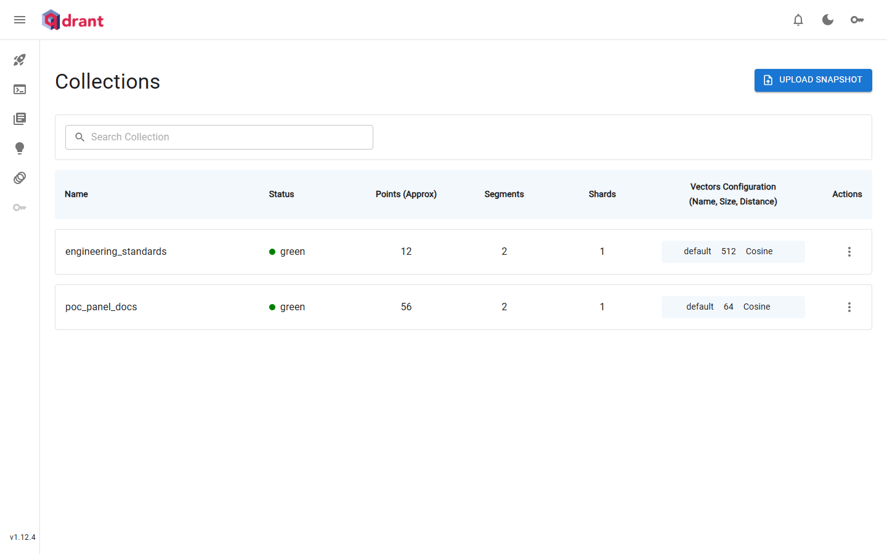
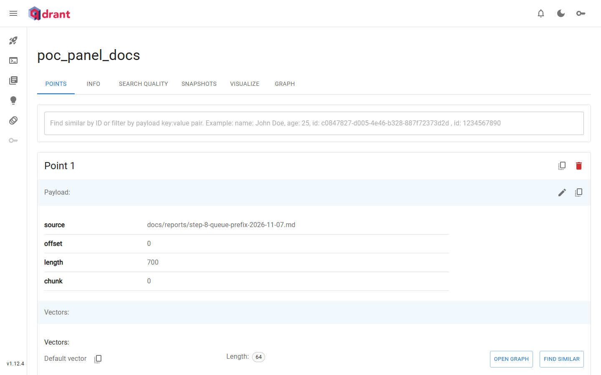

# A Qdrant POC on the panel's own reports

Run on 2026-11-09 against the Qdrant instance already running on this box. The corpus is five of this
repository's own reports, chunked by character offset, with a payload that names the file and the offset each
point came from. The point of the run is not retrieval quality: it is that a filtered vector search over the
panel's documents works end to end, that every request and response is on file with a measured latency, and
that the embedding gap is stated plainly rather than papered over with a model that is not there.

## Target and before state

- Endpoint: `http://127.0.0.1:6333`, reachable over loopback with no authentication.
- Version, from `GET /`: `{"title":"qdrant - vector search engine","version":"1.12.4","commit":"5b578c4f34188f0474f901e49d4726213596433d"}`.
- Container, from `docker ps`: `qdrant | qdrant/qdrant:v1.12.4 | Up 2 days | 127.0.0.1:6333-6334->6333-6334/tcp`. The row's claim that the instance has been up two days is confirmed by the container's own status, not assumed.
- Existing collection, listed before anything was created: `engineering_standards`, 12 points, 512 dimensions, Cosine. It was read once in the before listing and once in the after listing, and never written to. No existing collection was modified or deleted.
- POC collection: `poc_panel_docs`. The name says what it is, and it was removed at the end of the run (see Cleanup).

Before listing, exact response:

```json
{
  "result": {
    "collections": [
      {
        "name": "engineering_standards"
      }
    ]
  },
  "status": "ok",
  "time": 0.000009149
}
```

## Where the vectors come from

**No embedding service exists on this box.** Probed, not assumed:

- `http://127.0.0.1:11434/api/tags` (Ollama): connection refused.
- `http://127.0.0.1:1234/v1/models` (LM Studio): connection refused.
- No `OPENAI`, `DEEPINFRA` or `EMBED*` variable in the environment, and the panel's source has no embedding module, client or config: a repository-wide search for `embedding` and `qdrant`, run before this report existed, returned nothing.

So the vectors in this run are **deterministic stand-ins derived from the text**, and they are labelled as such everywhere they appear. The algorithm is exact and repeatable:

1. Lowercase the chunk, tokenize with `/[a-z0-9]+/g`.
2. Features are each token and each adjacent token bigram (`tok_a_tok_b`).
3. Hash each feature with FNV-1a 32 bit (offset basis `0x811c9dc5`, prime `0x01000193`).
4. Index is `hash % 64`; sign is positive when bit 31 is 0, negative when it is 1.
5. Weight is `1 + ln(count)` (sublinear term frequency).
6. L2-normalise the 64 values and round to six decimal places.

Identical text yields identical bytes on any machine, which is what makes the corpus and the query reproducible. It is a hashed bag of words: it rewards shared vocabulary, not meaning. Two passages that say the same thing in different words will not match. That limitation is the reason for the next paragraph.

**What the real source should be.** A sentence-embedding model, called by whatever ingests the documents. On this box the natural choices are `bge-m3` (1024 dimensions) or `nomic-embed-text` (768) served by Ollama beside Qdrant, or a hosted model such as `text-embedding-3-small` (1536) if egress and a key are acceptable. The collection's `size` must equal the model's dimension, so a production collection is created at that number, not at 64. The panel has no ingestion path today: the honest next step is one (read file, chunk, embed, upsert) behind config that names the embedding endpoint and model, keeping the `source` and `offset` payload exactly as this run keeps it, so a hit can be cited back to a file and a character position.

## The corpus

Five reports, chunked with a 700-character window and a 600-character stride, at most 12 chunks per file. The step-8 report is 4,805 characters, so it contributes 8 chunks; the larger files are sampled at their first 12 chunks. That is a bounded sample of each file, not the whole file, and the offsets are true character offsets into the file as committed, which is why a hit can be opened at the cited position.

| Source | Points | Character range covered |
| --- | --- | --- |
| `docs/reports/step-8-queue-prefix-2026-11-07.md` | 8 | 0 to 4804 |
| `docs/reports/token-spend-2026-11-06.md` | 12 | 0 to 7299 |
| `docs/reports/retired-worktrees-2026-11-05.md` | 12 | 0 to 7299 |
| `docs/reports/worktree-triage-2026-11-07.md` | 12 | 0 to 7299 |
| `docs/reports/unmerged-worktrees-2026-11-04.md` | 12 | 0 to 7299 |

Point payload, on every point:

```json
{
  "source": "docs/reports/step-8-queue-prefix-2026-11-07.md",
  "offset": 0,
  "length": 700,
  "chunk": 0
}
```

Payload keys: `source` (repository-relative path), `offset` (character offset of the chunk's first character), `length` (characters in the chunk), `chunk` (ordinal within the file). The chunk text itself is not stored in the payload; it is recoverable from the file at the offset, and keeping it out keeps the search response small enough to quote in full below. Total: **56 points**.

Collection configuration: 64 dimensions, Cosine distance, HNSW `m: 8`, `ef_construct: 64`, two default segments. Small numbers for a small corpus, not defaults for a production one.

## Calls, with measured latency

Every latency below is measured on the client with `performance.now()` around the fetch, including reading the response body. It is a single run with no warm-up and no repetition, so the numbers are indicative of this run and are not a benchmark. Qdrant's own `time` field is quoted beside each call as a second, independent reading.

| Step | Request | HTTP | Client latency (ms) | Response bytes |
| --- | --- | --- | --- | --- |
| `1-list-before` | GET `/collections` | 200 | 39.3 | 91 |
| `2-create-collection` | PUT `/collections/poc_panel_docs` | 200 | 641.5 | 48 |
| `3-upsert` | PUT `/collections/poc_panel_docs/points?wait=true` | 200 | 71.6 | 83 |
| `3b-collection-info` | GET `/collections/poc_panel_docs` | 200 | 5.3 | 809 |
| `4-filtered-search` | POST `/collections/poc_panel_docs/points/query` | 200 | 60.4 | 493 |
| `5-read-point` | GET `/collections/poc_panel_docs/points/2` | 200 | 13.0 | 670 |
| `6-list-after` | GET `/collections` | 200 | 1.9 | 116 |
| `7-delete-poc-collection` | DELETE `/collections/poc_panel_docs?timeout=10` | 200 | 88.9 | 48 |
| `8-list-final` | GET `/collections` | 200 | 2.2 | 91 |

### `1-list-before`

Request:

```
GET /collections
```

no body

Response, HTTP 200:

```json
{
  "result": {
    "collections": [
      {
        "name": "engineering_standards"
      }
    ]
  },
  "status": "ok",
  "time": 0.000009149
}
```

Measured latency: **39.3 ms** client side (fetch start to last body byte read); Qdrant's own `time` field: 0.01 ms.

### `2-create-collection`

Request:

```
PUT /collections/poc_panel_docs
```

```json
{
  "vectors": {
    "size": 64,
    "distance": "Cosine",
    "on_disk": false
  },
  "hnsw_config": {
    "m": 8,
    "ef_construct": 64
  },
  "optimizers_config": {
    "default_segment_number": 2
  }
}
```

Response, HTTP 200:

```json
{
  "result": true,
  "status": "ok",
  "time": 0.612325433
}
```

Measured latency: **641.5 ms** client side (fetch start to last body byte read); Qdrant's own `time` field: 612.33 ms.

### `3-upsert`

Request:

```
PUT /collections/poc_panel_docs/points?wait=true
```

Shape of the exact body (56 entries in `points`; the first is shown in full, the remaining 55 verbatim in the recorded asset named at the end of this file):

```json
{
  "points": [
    {
      "id": 1,
      "vector": [0.114614, -0.074892, -0.097029, -0.114614, 0, -0.057307, -0.017585, 0.062958, 0.17192, -0.022137, 0.149539, 0, 0.057307, -0.057307, 0, -0.177572, -0.057307, 0, 0.120265, 0.229227, 0.17192, 0.097029, 0, 0.292185, 0.120265, 0.057307, -0.114614, -0.057307, -0.155, -0.057307, 0.291087, 0.057307, 0.343841, 0, -0.114614, 0.17192, 0.154336, 0, 0.097029, -0.297836, 0.097029, 0, 0.057307, 0.057307, -0.039722, -0.17192, -0.057307, -0.120265, 0.114614, -0.057307, 0.120265, 0.057307, 0.057307, 0, 0, 0.17192, -0.251364, 0.057307, 0.097029, -0.039722, -0.120265, -0.057307, 0.057307, -0.057307],
      "payload": {
        "source": "docs/reports/step-8-queue-prefix-2026-11-07.md",
        "offset": 0,
        "length": 700,
        "chunk": 0
      }
    },
    "...55 more, see asset..."
  ]
}
```

Body size: 35454 bytes; SHA-256 of the exact body: `0b5115e21f289a2bb3bf0fc78c341e585b8dc5da25532c3985117da7482e51b7`.

Response, HTTP 200:

```json
{
  "result": {
    "operation_id": 0,
    "status": "completed"
  },
  "status": "ok",
  "time": 0.050651178
}
```

Measured latency: **71.6 ms** client side (fetch start to last body byte read); Qdrant's own `time` field: 50.65 ms.

### `3b-collection-info`

Request:

```
GET /collections/poc_panel_docs
```

no body

Response, HTTP 200:

```json
{
  "result": {
    "status": "green",
    "optimizer_status": "ok",
    "indexed_vectors_count": 0,
    "points_count": 56,
    "segments_count": 2,
    "config": {
      "params": {
        "vectors": {
          "size": 64,
          "distance": "Cosine",
          "on_disk": false
        },
        "shard_number": 1,
        "replication_factor": 1,
        "write_consistency_factor": 1,
        "on_disk_payload": true
      },
      "hnsw_config": {
        "m": 8,
        "ef_construct": 64,
        "full_scan_threshold": 10000,
        "max_indexing_threads": 0,
        "on_disk": false
      },
      "optimizer_config": {
        "deleted_threshold": 0.2,
        "vacuum_min_vector_number": 1000,
        "default_segment_number": 2,
        "max_segment_size": null,
        "memmap_threshold": null,
        "indexing_threshold": 20000,
        "flush_interval_sec": 5,
        "max_optimization_threads": null
      },
      "wal_config": {
        "wal_capacity_mb": 32,
        "wal_segments_ahead": 0
      },
      "quantization_config": null,
      "strict_mode_config": {
        "enabled": false
      }
    },
    "payload_schema": {}
  },
  "status": "ok",
  "time": 0.002197504
}
```

Measured latency: **5.3 ms** client side (fetch start to last body byte read); Qdrant's own `time` field: 2.20 ms.

The `points_count` of 56 is the server's count after the upsert with `wait=true`, not the number the client hoped it sent.

### `4-filtered-search`

Query text: *what changed in server.js when the assistant queue prefix moved into routes*

Request:

```
POST /collections/poc_panel_docs/points/query
```

```json
{
  "query": [0, 0.208514, 0, 0, 0, 0, 0, 0, 0, -0.208514, 0.208514, 0, 0, 0, 0, 0, -0.208514, -0.208514, 0.208514, 0, 0, 0, 0, 0.208514, 0, 0.208514, 0, 0.208514, -0.208514, 0, 0, 0, 0, 0, 0, 0.208514, -0.208514, 0, 0, -0.417029, 0, -0.208514, 0, -0.208514, 0, 0, 0, -0.208514, 0.208514, 0, 0, 0, 0, 0, 0, 0, -0.208514, 0, 0, 0.208514, -0.208514, 0, 0, 0],
  "filter": {
    "must": [
      {
        "key": "source",
        "match": {
          "value": "docs/reports/step-8-queue-prefix-2026-11-07.md"
        }
      }
    ]
  },
  "limit": 3,
  "with_payload": true,
  "with_vector": false
}
```

Response, HTTP 200:

```json
{
  "result": {
    "points": [
      {
        "id": 2,
        "version": 0,
        "score": 0.39233416,
        "payload": {
          "source": "docs/reports/step-8-queue-prefix-2026-11-07.md",
          "offset": 600,
          "length": 700,
          "chunk": 1
        }
      },
      {
        "id": 1,
        "version": 0,
        "score": 0.38455826,
        "payload": {
          "source": "docs/reports/step-8-queue-prefix-2026-11-07.md",
          "offset": 0,
          "length": 700,
          "chunk": 0
        }
      },
      {
        "id": 8,
        "version": 0,
        "score": 0.29143798,
        "payload": {
          "source": "docs/reports/step-8-queue-prefix-2026-11-07.md",
          "offset": 4200,
          "length": 605,
          "chunk": 7
        }
      }
    ]
  },
  "status": "ok",
  "time": 0.039094618
}
```

Measured latency: **60.4 ms** client side (fetch start to last body byte read); Qdrant's own `time` field: 39.09 ms.

All 3 hits come from `docs/reports/step-8-queue-prefix-2026-11-07.md`, the one source the filter names, so the payload filter held. Scores are term-overlap from the stand-in vector, not semantic similarity; the ranking is evidence that the plumbing works, not that the model is good.

### `5-read-point`

Request:

```
GET /collections/poc_panel_docs/points/2
```

no body

Response, HTTP 200:

```json
{
  "result": {
    "id": 2,
    "payload": {
      "source": "docs/reports/step-8-queue-prefix-2026-11-07.md",
      "offset": 600,
      "length": 700,
      "chunk": 1
    },
    "vector": [0.12262, -0.06131, 0, -0.12262, -0.06131, -0.207614, -0.06131, 0.06131, 0.183931, -0.128666, 0.171163, 0.042497, 0.06131, 0, -0.06131, 0, 0.128666, 0.183931, 0.042497, 0.06131, -0.042497, 0.103807, 0.183931, 0.189976, 0, 0, -0.183931, 0, -0.279878, 0, 0.06131, 0.103807, 0.12262, 0, 0, 0.12262, 0, -0.12262, 0.103807, -0.292608, -0.042497, 0, 0.146304, -0.103807, -0.018813, -0.245241, 0, -0.12262, 0.12262, -0.06131, 0.245241, -0.042497, 0, -0.226427, 0, -0.06131, -0.159985, -0.06131, 0.12262, 0, -0.226427, 0.245241, 0, -0.12262]
  },
  "status": "ok",
  "time": 0.002690844
}
```

Measured latency: **13.0 ms** client side (fetch start to last body byte read); Qdrant's own `time` field: 2.69 ms.

Point 2's payload matches the chunk at offset 600 of `docs/reports/step-8-queue-prefix-2026-11-07.md`, which is the same point the filtered search ranked first. The stored vector has 64 components, the collection's size.

### `6-list-after`

Request:

```
GET /collections
```

no body

Response, HTTP 200:

```json
{
  "result": {
    "collections": [
      {
        "name": "engineering_standards"
      },
      {
        "name": "poc_panel_docs"
      }
    ]
  },
  "status": "ok",
  "time": 0.00000466
}
```

Measured latency: **1.9 ms** client side (fetch start to last body byte read); Qdrant's own `time` field: 0.00 ms.

## Screenshots

Both captured with headless Chromium at a fixed 1440 by 900 viewport, device scale factor 1, page scrolled to the top, no full-page stitching. The dashboard needed no login.

Landing surface, `http://127.0.0.1:6333/dashboard`:



- `docs/reports/assets/ai-factory-poc/qdrant-dashboard-1440x900.png`, 1440x900, 47,536 bytes.
- Shows both collections: `engineering_standards` (12 points, 512 Cosine) and `poc_panel_docs` (56 points, 64 Cosine), neither red.

Collection listing, `http://127.0.0.1:6333/dashboard#/collections/poc_panel_docs`:



- `docs/reports/assets/ai-factory-poc/qdrant-collection-poc-panel-docs-1440x900.png`, 1440x900, 56,222 bytes.
- Shows point 1 with its payload (`source` `docs/reports/step-8-queue-prefix-2026-11-07.md`, `offset` 0, `length` 700, `chunk` 0) and a 64-component default vector.

## Cleanup, and why the collection is gone

The POC collection was deleted after the screenshots and the last listing, so the instance is left exactly as it was found: `engineering_standards` only. The evidence survives in the recorded bodies and the screenshots above. Leaving a 56-point POC collection on a shared instance would be a nameless orphan the next reader has to guess about; the name said POC, but the clean state is the better default, and the run is repeatable from this document.

Request:

```
DELETE /collections/poc_panel_docs?timeout=10
```

no body

Response, HTTP 200:

```json
{
  "result": true,
  "status": "ok",
  "time": 0.062713994
}
```

Measured latency: **88.9 ms** client side (fetch start to last body byte read); Qdrant's own `time` field: 62.71 ms.

Request:

```
GET /collections
```

no body

Response, HTTP 200:

```json
{
  "result": {
    "collections": [
      {
        "name": "engineering_standards"
      }
    ]
  },
  "status": "ok",
  "time": 0.000004589
}
```

Measured latency: **2.2 ms** client side (fetch start to last body byte read); Qdrant's own `time` field: 0.00 ms.

## What this run does not prove

- Nothing about retrieval quality. 56 points, 64 hashed dimensions and a lexical stand-in cannot rank semantically; the filtered search proves the request path, the filter and the payload round trip.
- Nothing about throughput or p99. Each call was made once; the create call's 641.5 ms includes the segment and WAL setup the server does on first write.
- Nothing about persistence across a restart, replication, or payload indexing at scale. No payload index was created, which is fine at 56 points and wrong at a million.
- Nothing about the panel. No application code was changed; there is no ingestion path, no embedding client and no query route in the panel today.

## Reproduce it

The exact request and response for every call, including all 56 vectors in the upsert body and the full 64-float query vector, is committed beside this file:

- `docs/reports/assets/ai-factory-poc/qdrant-calls.json`, compact JSON, 50532 bytes, SHA-256 `7d735ac4d8cf8d4e6a92d0a44627d53f10b203bb2e1ca79a47ab9cb0b5604221`.
- Structure: `calls[]` with `step`, `request` (`method`, `path`, `body`, `body_sha256`), `response` (`status`, `body`, `bytes`) and `latency_ms`; plus `corpus[]` with each point's `id`, `source`, `offset`, `length` and `chunk`.

To repeat on a fresh instance: create the collection with the body in call `2-create-collection`, re-chunk the five files with the rule above, embed each chunk with the six steps in "Where the vectors come from", and replay the bodies in call order. Point ids are 1 to 56 in corpus order, so `5-read-point` and the search hits are stable.
