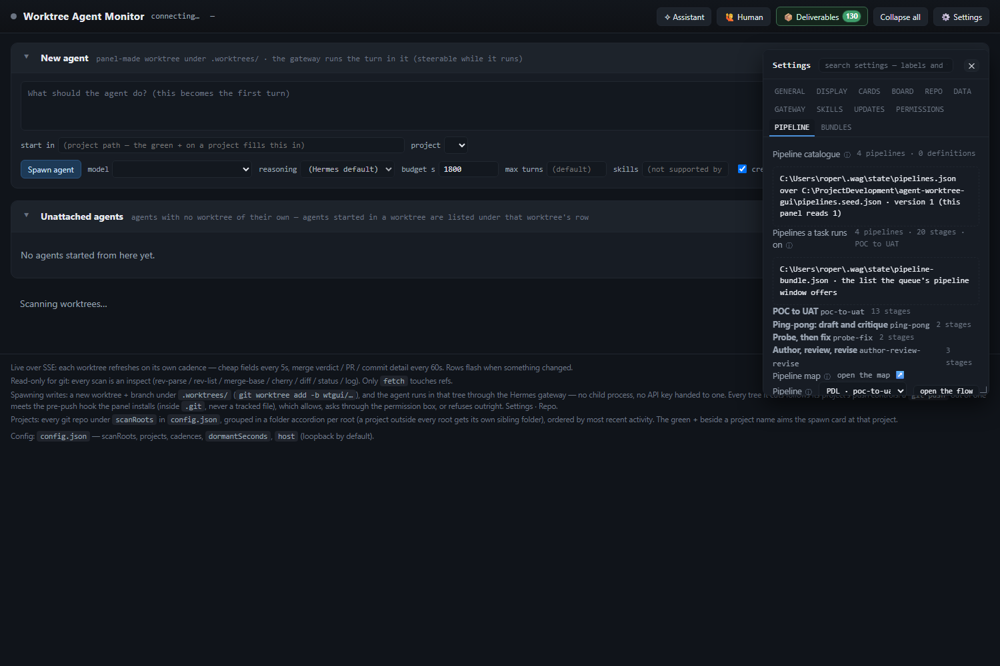
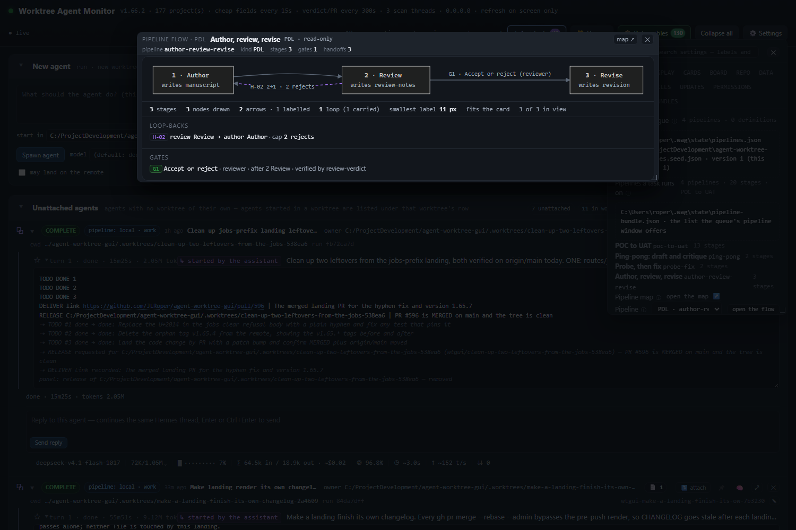

# The pipeline catalogue, repaired from the bundle it actually reads

Written 2026-11-08. The Pipeline tab works again on this install: Settings > Pipeline lists the reader's four
pipelines, every one of them draws from "open the flow", and `author-review-revise` walks its documented reject loop
through a task. The loader that refused the file is unchanged, and its refusal is still pinned by a test.

## 1. Where the stores actually are

Both were resolved from the code, not guessed. `lib/paths.js` `statePaths()` puts every panel state file in the
`stateDir`, which is `dirname(config.jobsFile)`, which defaults to `<dataDir>/state`; `resolveDirs()` defaults
`dataDir` to `<home>/.wag`. On this host that is:

| what | path | today |
|---|---|---|
| the ladder catalogue the reader edits | `<home>/.wag/state/pipelines.json` (`config.pipelinesFile`) | 337 bytes, `{"version":1,"pipelines":[]}` - **0 definitions** |
| the shipped ladder seed it is merged over | `pipelines.seed.json` at the repo root | ships **empty by design** |
| the PDL bundle a task is put on | `<home>/.wag/state/pipeline-bundle.json` (`config.pipelineBundleFile`) | 171,744 bytes, **4 pipelines**, refused whole |
| the per-tree pipeline record | `<home>/.wag/state/pipeline-records.json` (`config.pipelineRecordsFile`) | not involved in this fault |
| the shipped PDL seed | `pipeline-bundle.seed.json` at the repo root | 11 pipelines, loads |

`lib/store.js` is the board's in-memory store for projects and rows; it carries no pipeline catalogue and was not part
of this repair. `lib/pipelines.js` is the ladder (the reader's file over the empty seed); `lib/pipeline-bundle.js` is
the PDL loader the Pipeline tab, the queue's assign control and the map page all read through
`lib/pipeline-source.js`.

## 2. Why the tab was empty, and why the ladder seed cannot fix it

`pipelines.json` holds no definition, and `pipelines.seed.json` says in its own note that the seven that used to live
there are gone - they are PDL documents in `pipeline-bundle.seed.json` now. So the catalogue the tab draws is the
bundle, and the bundle was refused:

```
incomplete-gate at pipelines[3].gates[0].decision.routes: gate G1 of pipeline author-review-revise declares outcomes
accept, reject and no "routes" map, and the stage it follows (review) has 2 ways out (H-02, H-03) - the driver would
fall back to its edge kind order and take the sequence edge, ignoring the verdict.
```

That refusal is correct: `H-02` is the capped loop back to `author` and `H-03` the sequence on to `revise`, so without a
map a `reject` reads as progress. The file predates the rule (the seed gained its `routes` two hours after this file
was written), and a seed change never reaches a reader's copy. Editing the ladder seed would repair nothing: the tab
does not list ladder definitions when the bundle is what it draws, and the queue's assign control reads the bundle
alone.

## 3. The repair: the seed's own routes, written into the reader's document

`tools/repair-pipeline-bundle.mjs` (planning in `lib/pipeline-bundle-repair.js`) does the one thing that is neither a
guess nor a replacement:

- it copies the routes the **shipped seed declares for the same pipeline and gate** - `accept -> H-03`,
  `reject -> H-02` on `author-review-revise` G1 - and writes them into the live file;
- it validates every route against the **live** document's own handoffs (the target must exist and leave the gate's
  own stage), and refuses the whole plan when the seed has no answer or the two documents disagree;
- it runs `parseBundle` over the result **before** writing, so "repaired" means the panel's own loader accepts it;
- it writes `"decision": null` on each gate that declares no decision, which is the loader's own word for a pause.

A deep comparison of the live file before and after finds **seven changes and nothing else**:

```
pipelines[0].gates[0..4].decision: ADDED null      (poc-to-uat G0-G4)
pipelines[1].gates[0].decision:    ADDED null      (ping-pong G1)
pipelines[3].gates[0].decision.routes: ADDED {"accept":"H-03","reject":"H-02"}   (author-review-revise G1)
```

| | before | after |
|---|---|---|
| bytes | 171,744 | 172,014 |
| sha256 | `aa5915f00d35bdb982790a21c925731c5606ed3a35a7fe243623bfb385c56f2b` | `aaa06f49ada46c532fddfb585e80168464842f7bf495a42464b56cb50ff6d169` |
| loader | `ok:false`, `incomplete-gate` | `ok:true`, 4 pipelines: `poc-to-uat` 13, `ping-pong` 2, `probe-fix` 2, `author-review-revise` 3 |
| `GET /api/pipelines` `pdl` | `ok:false`, `pipelines: []` | `ok:true`, 4 pipelines, G1 routes shown |

### The six other gates

Six gates in the file declare no decision at all: `poc-to-uat` G0-G4 and `ping-pong` G1. None of them declares an
outcome, so none can have a route - a route is an outcome-to-edge map, and these gates have no outcome to map. What
they get is the explicit null, so the file says "this is a pause" instead of leaving an absent key to be read as an
omission. That is not a weakening of anything: the loader already treats a gate with no decision as a pause, and the
driver already refuses to treat a pause as a barrier (lib/task-pipeline-drive.js rule 5). One of the six sits on a
stage with two ways out (`poc-to-uat` G3 after S10, where H-12 loops back to S9 and H-13 goes on to S11), and the rail
rule - sequence before loop - is what the driver does with a pause there, by design; giving it a decision would mean
inventing a decision record the studio never declared (an id, a path, a schema and a writer), which is the one thing
the repair must not do.

## 4. The guard still refuses

Left exactly as it was. `test/pipeline-bundle-repair.test.js` builds the reader's file - the seed's four pipelines with
G1's routes removed - and pins that:

- `parseBundle` refuses it, `code: incomplete-gate`, `where: pipelines[3].gates[0].decision.routes`, naming the gate,
  the pipeline and the two ways out;
- the repair, not the loader, is what makes it load (`accept -> H-03`, `reject -> H-02`);
- a model with no routes for the gate **refuses the plan** and returns no document;
- a model route that names a handoff the live pipeline does not hold **refuses the plan** rather than writing a dead
  edge;
- a gate whose stage has one way out is left alone: the loader never needed a map there.

## 5. Proof

**The live panel, in Chromium.** Settings > Pipeline was driven at `127.0.0.1:7331` against the repaired state file:
35 checks, 0 failed. The tab reads `4 pipelines · 0 definitions`, the source line names
`<home>/.wag/state/pipeline-bundle.json`, the repair control is gone, the dropdown offers exactly
`pdl:poc-to-uat, pdl:ping-pong, pdl:probe-fix, pdl:author-review-revise`, and "open the flow" drew **13, 2, 2 and 3**
stage nodes with **5, 1, 0 and 1** gates and **3, 1, 0 and 1** loops.





**One pipeline through a task.** `tools/verify-pipeline-walk.mjs --only author-review-revise --bundle
<home>/.wag/state/pipeline-bundle.json` drove a queue row through the panel's own clock
(`Assistant.sweepQueues`) with a scripted seat: **4 / 4 checks**. The row went
`author#1 -> review#1 -> author#2 -> review#2 -> author#3 -> review#3 -> revise#1`, crossings
`H-01:3, H-02:2, H-03:1`, the seat's verdicts `reject, reject, accept`, and the row finished `done` on `revise`. Before
the repair the same walk on the same bundle took `H-03` on the first `reject` and never entered the loop; with the
routes written, the reject edge is the one the record chooses.

**The gates.**

| command | result |
|---|---|
| `node --test test/pipeline-bundle.test.js test/pipeline-bundle-import.test.js test/pipeline-catalogue-route.test.js test/pipeline-bundle-seed.test.js test/pipeline-flow.test.js test/settings-pipeline-tab-pdl.test.js test/task-pipeline-drive.test.js test/pipeline-bundle-repair.test.js` | 94 tests, 94 pass |
| `node tools/verify-pipeline-catalogue.mjs` | 38 passed, 0 failed |
| `node tools/verify-pdl-pipelines.mjs` | 49 checks, 0 failed |
| `node tools/verify-pipeline-walk.mjs` (the seed, all five walks) | 34 / 34 checks |

Two gates were stale on `main` before this change and are repaired here, because they are the ones that read the
catalogue: `verify-pipeline-catalogue.mjs` still expected the four-pipeline seed and seven ladder definitions (the seed
carries eleven and the ladder ships empty), and `verify-pipeline-walk.mjs` still expected a `probe-fix` row to end on
"PR reads MERGED" when the driver now settles it on the stage's own verdict because `fix` declares a patch.

## 6. What was not changed

- `lib/pipeline-bundle.js` - the refusal, the route validation and the whole-or-not-at-all rule.
- `lib/task-pipeline-drive.js` - the gate barrier, the routes-read-first rule and the cap.
- `pipeline-bundle.seed.json` - its `author-review-revise` G1 already carries the map, and its first pipeline is the
  studio's export carried verbatim; the seed was the model, not the patient.
- `pipelines.seed.json` - still empty, still by design.
- The reader's `pipelines.json` - untouched; the tab's four come from the bundle, which is what the code reads.

## 7. Reproduce

```bash
# what the live file says, and what the panel answers
node --input-type=module -e "import { readBundle } from './lib/pipeline-bundle.js'; const r = readBundle('<home>/.wag/state/pipeline-bundle.json'); console.log(r.ok, r.code || '', r.ok ? r.bundle.pipelines.map(p => p.id + ':' + p.stages.length) : r.reason)"
curl -s http://127.0.0.1:7331/api/pipelines | node -e "let s='';process.stdin.on('data',d=>s+=d).on('end',()=>{const j=JSON.parse(s);console.log('pdl',j.pdl.ok,j.pdl.pipelines.length,'ladder',Object.keys(j.pipelines).length)})"

# the repair, on a copy first (a dry run writes nothing)
cp <home>/.wag/state/pipeline-bundle.json /tmp/bundle.json
node tools/repair-pipeline-bundle.mjs --file /tmp/bundle.json
node tools/repair-pipeline-bundle.mjs --write          # the install's own bundle

# the walk on the reader's document
node tools/verify-pipeline-walk.mjs --only author-review-revise --bundle <home>/.wag/state/pipeline-bundle.json --out <dir>

# the guards
node --test test/pipeline-bundle-repair.test.js
node tools/verify-pipeline-catalogue.mjs
```
