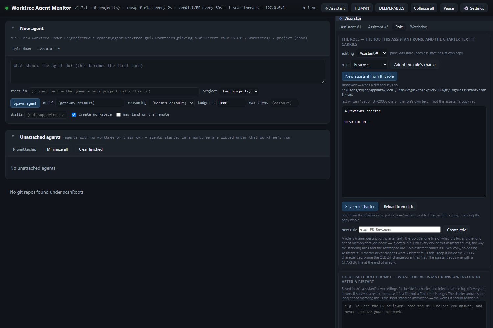
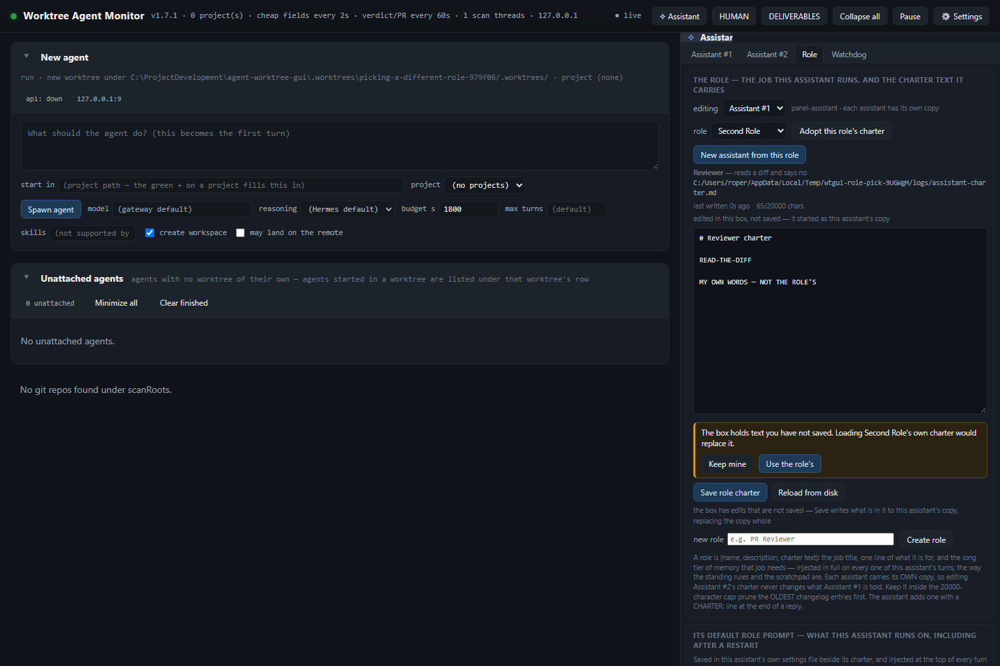
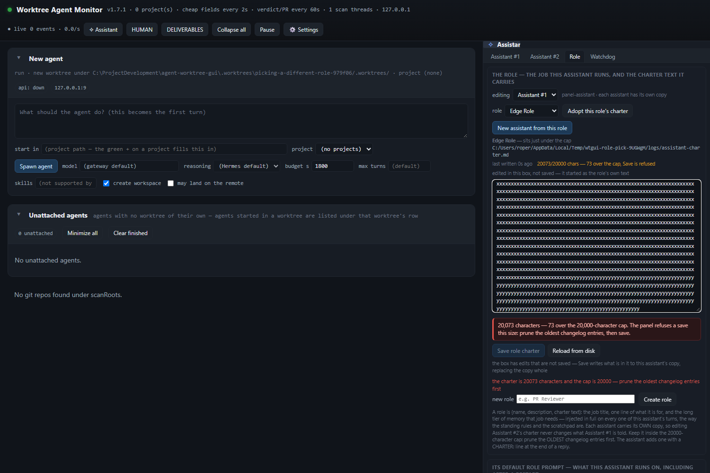

# The Role tab's picker loads the role's own charter — and the box says what it holds

**2026-11-04 · v1.8.0**

The Role tab had two boxes that could disagree: `#as-role-pick` changed the job title and the description line,
while `#as-role-text` kept the PREVIOUS role's charter until **Adopt this role's charter** was pressed or the page
reloaded. The brief for this change said the picker moved the description line; reading the handler showed it moved
nothing at all.

## What was actually wrong

`public/assistant.js` bound the picker's change on

```js
if (el.dataset.asRolepick) { … }
```

but the markup is `data-as-role-pick`, whose dataset key is `asRolePick` — and because the attribute is valueless,
that key is the empty **string**, which is falsy. The handler never ran. The target selector (`#as-roletarget`,
`data-as-roletarget`) had the identical dead check, so the tab could not even switch which assistant it was
editing; `tools/verify-assistant-subtabs.mjs` waited for Assistant #2's text after selecting it and only passed
because nothing else was measured in between. Both now test for **presence** (`!== undefined`), not truth.

## What the tab does now

- **A pick loads that role's own charter.** A new `GET /api/assistant/role/charter?roleId=` returns one role's
  text and cap from the role library (the pane's read stays meta-only, so the 20 KB body is fetched per pick).
  The pick itself is still `POST /api/assistant/role/pick` with `adopt:false`, and **Save** still writes the
  editing assistant's copy through `PUT /api/assistant/role`.
- **The box says which text it holds.** Above it: `the role's own text — not this assistant's copy yet` or
  `this assistant's own copy — edited from the role's text`, and a draft reads
  `edited in this box, not saved — it started as …`. The sentence under the buttons follows: a role's text says
  Save writes it to this assistant's copy; the copy says saving replaces it whole.
- **A dirty box is never silently discarded.** Changing the picker opens an inline row in the tab (no browser
  dialog) — *The box holds text you have not saved. Loading Second Role's own charter would replace it.* — with
  **Keep mine** / **Use the role's**. Keep mine changes nothing and puts the picker back; Use the role's loads
  the pick. The same row covers Adopt, Reload from disk, and switching the assistant being edited.
- **The 20,000-character cap is checked against the text that would be sent**, on landing and while typing. Over
  it, the size line turns amber, a warning row sits between the box and the buttons, and Save is disabled before
  a press the server would refuse with 413; a forced press refuses locally and writes nothing.
- **Adopt still works**, asking through the same row when the copy differs.

## Proof, on a sandbox panel and a real browser

`npm run verify:role-pick-charter` boots its own panel (own `PANEL_CONFIG`, own `HERMES_HOME`, own port) and
drives headless Chromium over it. It creates five roles, including one at exactly **19,773** characters and one
at **20,001**, and asserts:

| Step | What is proved |
|---|---|
| clean pick | the box becomes the Reviewer's 34-character charter; the description line is the Reviewer's; the provenance says the role's own text; the assistant's copy on disk is byte-identical |
| Save | the copy becomes the Reviewer's text and `sameAsRole` reads true; the provenance flips to the copy |
| dirty pick | the inline row appears with both answers, the typed words stay in the box, **no request was sent**, the picker shows the move, the description line still describes the text on screen |
| Keep mine | the words stay, the picker returns to the role the assistant runs, the server is unchanged |
| Use the role's | the box becomes Second Role's charter, the server role follows, the copy is still the last saved text |
| target switch | the same row, naming Assistant #2; Keep mine leaves the editor on #1 and keeps the words |
| Adopt | the inline row, then the copy becomes the role's text, `sameAsRole` true |
| cap, under | the 19,773-character role loads with no warning and Save live |
| cap, crossed | typing to 20,073 raises the warning with the numbers, disables Save, and a forced press refuses without a write |
| cap, on land | a 20,001-character role warns the moment it lands and Save is disabled |
| health | zero browser dialogs and zero page errors |

```
72 checks, 0 failed
ROLE-PICK-CHARTER-OK
```

The same gate on `HEAD~1` (the base, exported with `git archive`) fails at the pick: the box keeps the old
charter, the description does not move, the server role does not change, and there is no inline row — 19 failures
before it stops on the missing markup. `tools/verify-assistant-subtabs.mjs` stays green at **181 checks**, and
`npm test` is **1421 pass / 0 fail**.







## Files

- `public/assistant.js` — the pick, provenance, inline row, cap check and Adopt/Reload guards.
- `public/style.css` — the inline row's amber/red band.
- `server.js`, `lib/assistant.js` — `GET /api/assistant/role/charter` and `roleCharterPayload()`.
- `test/roles.test.js` — the per-role read's contract, including an over-cap role and an unknown id.
- `tools/verify-role-pick-charter.mjs` — the live gate (`verify:role-pick-charter`).
