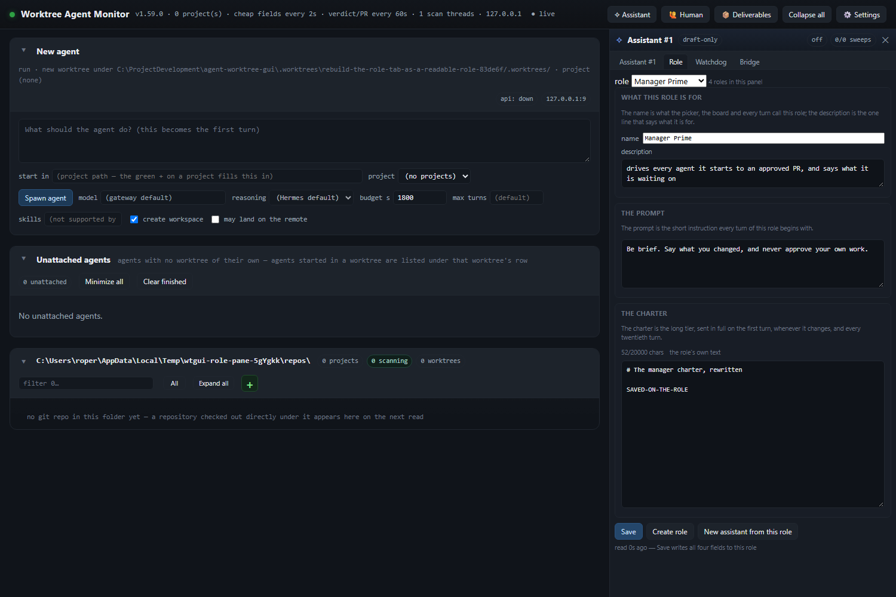
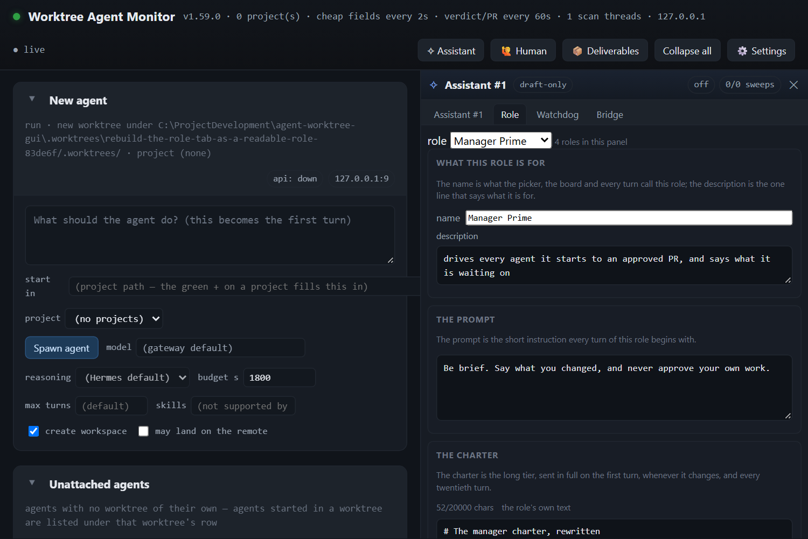
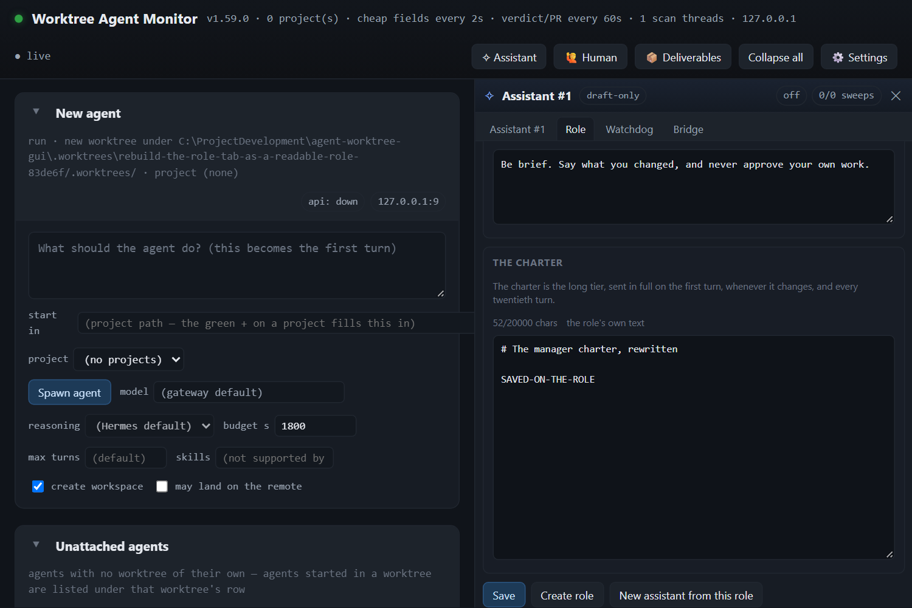

# The Role tab is a role editor, and a role's charter can be saved

**2026-11-08 · v1.59.0**

The Role tab edited one assistant's copy of a role. Its header carried the assistant's thread id, its help text
explained that "each assistant has its own copy" and that editing Assistant #2's charter never changed what
Assistant #1 was told, and its picker was a read-only preview of other roles' charters: picking one put that role's
text in a disabled box, Save was refused, and a second press (Reload) was the way back. Three subjects (a role's
text, an assistant's copy, and a preview) shared one box.

It is now a role editor: one selector, three groups, one save.

## The shape

| Group | What it holds | The sentence under the heading |
|---|---|---|
| What this role is for | name, description | the name is what the picker, the board and every turn call this role; the description is the one line that says what it is for |
| The prompt | the short instruction | it is the short instruction every turn of this role begins with |
| The charter | the long tier | it is sent in full on the first turn, whenever it changes, and every twentieth turn |

Save, Create role and New assistant from this role sit together in one actions block at the bottom. Every
per-assistant reference is gone: the thread id, the copy sentence, the Assistant #2 versus #1 paragraph, and the
preview dance (its read-only box, its Keep/Use question and the Reload button). Which role an assistant runs is
its own Settings' business; that row's Open Role tab press now points this editor at the role the record runs.

Create role makes a copy of the role the editor shows, named "<role> copy", and opens it, so the reader renames it
in the first group and saves. New assistant from this role starts another assistant on the role the editor shows.

## The missing save path

The library could read a role's own charter (`GET /api/assistant/role/charter`) but had no writer, so Save wrote an
assistant's copy of it. `PUT /api/assistant/role/charter` now writes the role's four fields in one atomic role write
(`lib/roles.js` `writeRole`), with the same 20,000-character cap (413), stale-save refusal (409) and unknown id
(404) every charter has. The editor reads and writes that path; a role save touches no assistant's charter file.

## The prompt moved onto the role

A role now carries `prompt`. The preamble reads the role's prompt when that assistant has no prompt of its own, so
the Role tab's prompt is live for every assistant that runs the role; an assistant's own prompt (the profile file
`POST /api/assistant/profile` writes) still wins. The role prompt travels in the same read as the charter, so the
editor opens on what is on disk rather than on an empty field.

## Proof

`npm run verify:role-pane` boots its own panel (own PANEL_CONFIG, own HERMES_HOME, own port) and drives headless
Chromium over it: 74 checks, 0 failed at v1.59.0. It proves the shape (one selector, three groups in order, one
sentence each, the presses at the bottom, no per-assistant words), the role's own read and PUT save (and that no
assistant's charter moved), the cap warning and a forced-press refusal, a pick loading another role's four fields,
the dirty-switch guard, Create role, New assistant from this role, zero browser dialogs and zero page errors.

`test/assistant-role-editor.test.js` pins the pane's markup and its draft; `test/roles.test.js` pins the save
contract (one write, `role-invalid`, `charter-too-long`, `charter-stale`, `role-unknown`) and the role prompt's
place in the preamble. `test/assistant-subtabs.test.js` and the assistant tests stay green. The full suite at this
tip is 2025 tests, 2023 pass, 2 fail: `test/ahead-behind-cell.test.js` (a source scan of `public/app.js` for a cell
that moved to `public/render-projects.js`) and `test/gateway-permissions.test.js` (reads a gitignored `config.json`
that only the primary checkout has). Both fail identically on a clean export of origin/main at f2c79be.

## Files

- `public/assistant.js` - the role editor's region, its save/pick/Create role/new-assistant handlers, and the
  Settings Open Role tab press.
- `public/index.html` - the Role tab's tooltip.
- `public/style.css` - the full-width name/remit fields and the remit caption.
- `server.js`, `lib/assistant.js`, `lib/roles.js` - `PUT /api/assistant/role/charter`, `saveRole`, `writeRole`,
  the role prompt, and the preamble's role-prompt fallback.
- `test/assistant-role-editor.test.js`, `test/roles.test.js`, `test/assistant-subtabs.test.js`.
- `tools/verify-role-pane.mjs` (the live gate), `tools/verify-assistant-subtabs.mjs`,
  `tools/verify-assistant-role-picker.mjs`.
