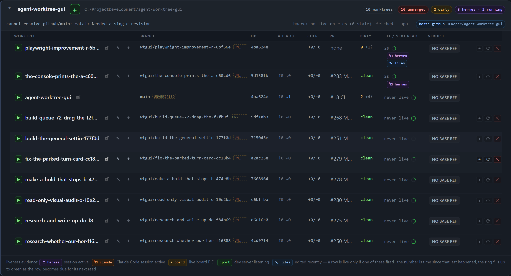
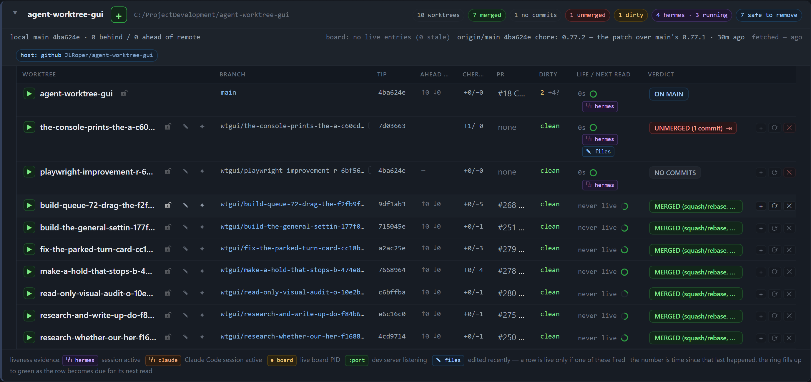

# Playwright round 1 — the Verdict column is blank for the panel's own project

- **Version:** v0.77.2 (`package.json`, and the board header reads `v0.77.2 · 1 project(s) · cheap fields every 5s · verdict/PR every 300s · 2 scan threads · 127.0.0.1`)
- **Run:** this worktree, `wtgui/playwright-improvement-r-6bf56e`, on its own instances — `http://127.0.0.1:7483` for the working board (queue, settings, chart, console, rail) and a fresh-store twin on `http://127.0.0.1:7485` for the as-shipped capture. Each has its own `dataDir`/`scratchDir` under `C:/Users/roper/AppData/Local/Temp/wag/90a8f9f6/inst*`, `scanRoots` an empty folder and one explicit project (`agent-worktree-gui`, path `C:/ProjectDevelopment/agent-worktree-gui`, GitHub `JLRoper/agent-worktree-gui`), `assistant.enabled: false`, `fetchSeconds: -1`, nothing shared with the reader's 7331 board.
- **Method:** a real Chromium (Playwright 1.64.1) against that instance, reading the page and `/api/state` in the same run; every claim below is a value read from the DOM or the API, not an impression. Two fresh browser contexts and a second, clean instance were used for the repeat and the contrast.

## What I looked at

| Surface | How | Result |
| --- | --- | --- |
| Board and cards | 1440×900, project folded and expanded, two seeded `done` cards under **Unattached agents** | Renders; 10 rows; 0 page errors, 0 console errors |
| Assistant queue sub-tab | drag, hold, park, requeue, done, Add task, Move | Behaves as documented — see “Queue checks” |
| Settings window | all 9 tabs, search, default 340×520 box | Tabs switch and the search filters with per-tab counts; one clipping wart queued below |
| Worktree chart | `table` width vs its card, rail closed and open | No clipping: 1325 px table / 1326 px card closed, 845 / 846 open at 1440, `main.scrollWidth === main.clientWidth` |
| Agent console | the seeded cards' turns, tool boxes, folds | 9 lines, 2 tool boxes, fold and `↓` controls present, no console/page errors |
| Docked rail at 480 px | the assistant rail's own width (`#assistant` = 480), cards 441 px, action strips 419 px | Nothing overflows the rail; the Move popover lands inside it (150×33 at x 985–1135, rail 960–1440) |

**Queue checks (all passed, so not this round's finding).** `#6` carries `hold → #1`; dragging it above `#1` was refused **twice**, the same way both times — the pane drew `#6 is held by #1 since 05:55 — it cannot move above it` and the order did not change. Dragging `#4` above `#1` was accepted and written to `assistant-1/queue.json` (`#4 order 2`, `#1 order 3`, `#6 order 4`). Parking, requeueing and completing a fresh row from its own glyphs changed both the DOM and the file at every step (probe row `#8`: `queued → parked → queued → done`). The Move popover opened inside the 480 px rail and was dismissed with Esc.

## The finding — a bug: every verdict in the panel's own project is `NO BASE REF`

### Steps

1. Start the panel with a project entry for `agent-worktree-gui` as the repository ships it (`config.json` on `main`):

   ```json
   { "name": "agent-worktree-gui", "path": "C:/ProjectDevelopment/agent-worktree-gui",
     "remote": "github", "mainBranch": "main", "prRepo": "JLRoper/agent-worktree-gui" }
   ```

2. Open the board and expand `agent-worktree-gui`.
3. Read the Verdict column, and the project's meta line.

### Expected

The same column the project gets when the remote name matches the checkout — `main` reads **ON MAIN**, the worktree rows read **MERGED (squash/rebase, N commits)** / **UNMERGED (N commits)** / **NO COMMITS** (see the contrast screenshot below, and `git rev-list --left-right --count origin/main...HEAD` works in every one of those trees).

### Actual

Every one of the project's 10 rows reads **NO BASE REF**. Read from the page and from `/api/state` in the same run:

```
RUN A: version v0.77.2 · 1 project(s) · … · 127.0.0.1
       noBase 10 / total 10            (each verdict cell: "NO BASE REF")
RUN A api: {"remote":"github","remoteRef":"github/main",
            "error":"cannot resolve github/main: fatal: Needed a single revision",
            "rowBase":["github/main"],"noBase":10}
```

The project's meta line on a fresh boot carries the same error (the row's spans render concatenated, so the page shows):

```
cannot resolve github/main: fatal: Needed a single revisionboard: no live entries (0 stale) fetched — agohost: github JLRoper/agent-worktree-gui
```

The checkout has no such remote:

```
$ git -C C:/ProjectDevelopment/agent-worktree-gui remote
origin
$ git -C C:/ProjectDevelopment/agent-worktree-gui rev-parse --verify github/main
fatal: Needed a single revision
$ git -C C:/ProjectDevelopment/agent-worktree-gui rev-parse --verify origin/main
4ba624e47192545b375e872db90f4a719bd640a4
```

**This is not an artefact of the sandbox.** The reader's own board on `127.0.0.1:7331` carries the same record right now:

```
live 7331: remote github remoteRef github/main
           error "cannot resolve github/main: fatal: Needed a single revision"
           rows 10  NO BASE REF 10  baseRefs ['github/main']
```

### Screenshot (this run, v0.77.2, `127.0.0.1:7485`, as-shipped `remote: github`)



The full 1440×900 board is `assets/playwright-round-1-board.png`.

### Why it happens

`lib/project.js` builds the comparison ref from the project record, never from what the repository actually has:

```js
const remoteRef = project.remote ? `${project.remote}/${project.mainBranch}` : project.mainBranch;
…
const meta = { remoteRef, hasRemote: Boolean(project.remote) };
if (!tip.ok) return { ...meta, error: `cannot resolve ${remoteRef}: ${tip.err || tip.out}` };
```

`Scheduler.ctxFor()` builds the same `${project.remote}/${project.mainBranch}` for every row scan, so `lib/scan.js` runs `git rev-list --left-right --count github/main...HEAD` in each tree, gets a failure, and sets `row.verdict = "NO BASE REF"` (`lib/scan.js:205-220`). One bad project field therefore blanks the whole column — `NO BASE REF` is project-wide, by construction.

The field is wrong for this repository: `config.json` on `main` gives **both** of its projects `"remote": "github"`, but `agent-worktree-gui`'s checkout has only `origin`, so the name resolves nowhere. The discovery probe already knows better — `lib/projects.js:62` and `:128` prefer a remote named `github`, then `origin`, then the first one — but an explicit `projects[]` entry carries `remote` through and nothing checks that it exists.

### The change I would make

1. **Ship the right remote for this repo** — `config.json`, `projects[]` entry for `agent-worktree-gui`: `"remote": "origin"` (or drop the key, so the probe's `github → origin → any` rule picks `origin` here). This is the one-line fix and it is enough: a clean instance seeded with the same project and `remote: origin` reads `ON MAIN` / `7 merged · 1 unmerged · 1 no commits` / `0 NO BASE REF` (`/api/state`: `remote origin, remoteRef origin/main, error null, rowBase ["origin/main"]`).
2. **Make the panel refuse to blank a column on a configured remote that is not in `git remote`.** `projectMeta()` and `ctxFor()` should fall back to the probe's answer (or to the repository's own `origin`/single remote) and say which remote they used, instead of returning a raw git fatal. The head line should name the fix (`the configured remote 'github' is not in this checkout (remotes: origin)`), not quote `git`'s `Needed a single revision`.
3. While there: the Verdict column ellipsizes its own words — `NO BASE REF` paints as `NO BASE R…` and `MERGED (squash/rebase, 5 commits)` as `MERGED (squash/rebase, …)` — in a 173 px cell. The chart's headers clip too: at 1440 `AHEAD / BEHIND` needs 109 px and gets 66 (`CHERRY` 61/56, `OWNER` 60/58), so the reader sees `AHEAD …`.

The contrast, same project, same build, a second clean instance on `:7484` with `remote: origin`:



### Reproduced twice

- **Run A** (fresh browser context, 1440×900, `:7483`): 10 / 10 rows `NO BASE REF`, `rowBase ["github/main"]`, project error `cannot resolve github/main: fatal: Needed a single revision`.
- **Run B** (a second fresh context, same instance, minutes later): identical — 10 / 10 `NO BASE REF`, same API values, same meta error.
- **Run C** (a fresh store on `:7485`, as-shipped `remote: github`, clean boot): 10 / 10 `NO BASE REF`, and the meta line quotes the git fatal — the capture in this document.
- Same reading on the reader's live `7331` board (quoted above); a clean instance with the corrected remote reads 0 / 10.

## Queued for later rounds (seen, not this round's finding)

- **Settings is 340 px wide by default, and some of its long rows are clipped.** On **Data**, the two directory paths are cut mid-path inside a 308 px preview box (379 px and 399 px of text), and the body then scrolls sideways: `scrollWidth 414` vs `clientWidth 338`. On **Skills**, the gateway line (`http://127.0.0.1:8642 · /v1/skills answers …`) is 488 px in the same 308 px box. On **Permissions**, each `perm-source` path is 286 px in a 114 px cell. The *Board* tab does not overflow (I first read the screenshot as a clipped unit; the DOM says `scrollWidth === clientWidth === 338`). Wrapping the path spans (`word-break: break-all`), or ellipsizing them with a `title=`, would fix the class.
- **`NO BASE REF` and `MERGED (squash/rebase, …)` are ellipsized in the chart** at 1440 (173 px cell), and the `AHEAD / BEHIND` header is ellipsized to `AHEAD …` at every width measured; the verdict cell does carry a `title` in the working state (`Against origin/main: 0 ahead, 0 behind.`), and I did not read that title while the base was missing.

## Evidence

All shots are PNGs of the real page (Playwright, `deviceScaleFactor: 2`), captured by the run that read the numbers above.

| File | What it shows |
| --- | --- |
| `assets/playwright-round-1-no-base-ref.png` | the project card, v0.77.2, `remote: github`: 10 / 10 `NO BASE REF` |
| `assets/playwright-round-1-board.png` | the whole board at 1440×900 in that state |
| `assets/playwright-round-1-expected.png` | the same project with `remote: origin`: `ON MAIN`, merged/unmerged/no-commits verdicts |
